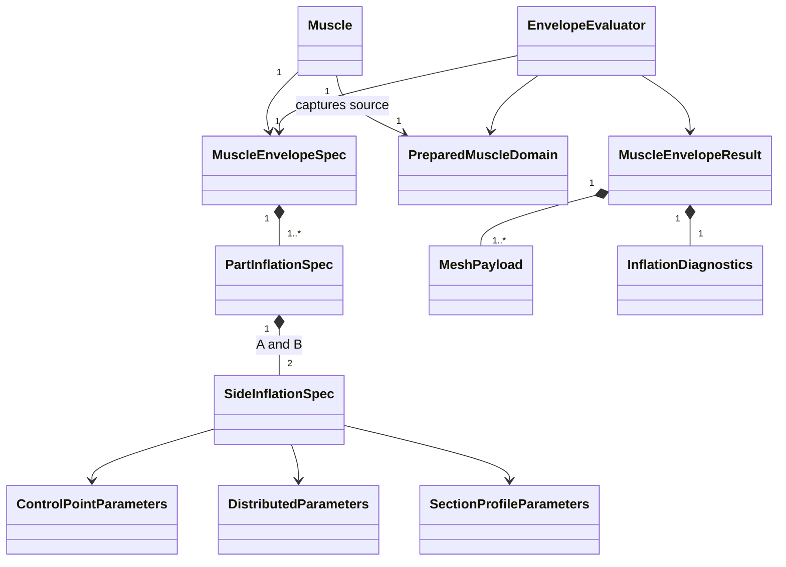

# Bidirectional muscle inflation

Status: proposed implementation design, 2026-09-26. Code inspection supports the integration points below; the new geometry behavior has not yet been implemented or validated. This document is not an anatomical acceptance report.

## 1. Product behavior and scope

A muscle keeps one fiber-defined reference surface. It can produce one inflated surface, as today, or two independently configured surfaces on opposite sides of that reference. There is still one muscle, one source Fiber Surface/legacy fiber collection, and one set of attachments.

This is useful for an interosseous muscle such as FDI whose broad faces are not both constrained against bone. It does not require anatomical heads to become separate native parts. Head separation remains a decision about the intended external form and necessary control.

Two-sided inflation is an output arrangement, not a fourth inflation algorithm. Each side uses Control Point, Distributed, or Section Profile within that algorithm's supported domain. Different algorithms can be selected on opposite sides.

Fixed decisions:

- Existing files default to One Side and retain their existing geometry and settings.
- The base does not move, recenter, resnap, or regenerate when inflation settings change. Neither Free nor Controlled fibers run their solver for an inflation edit.
- Side A initially means the existing inflation side. Side B means the opposite side. These are material-side identities, not world directions or anatomical labels.
- Depth/amount describes distance from the base on that side, not total muscle thickness. There is no implicit division by two.
- Each side has independent settings. Provide explicit Copy A to B and Copy B to A actions; do not introduce a persistent linking state in this version.
- Switching to Both Sides for the first time initializes B by copying A, including each branch's settings. A stays unchanged. The UI explains that this adds thickness on the opposite side. Later toggles restore the saved B settings. Authoring may instead supply an explicit B configuration, including zero depth.
- Turning inflation off displays the base once. Turning B off while in Both Sides keeps B coincident with the base: the result is an inflated A surface with a flat reference-side surface. Returning to One Side restores the existing single-surface output convention.
- No automatic fitting, collision repair, base relocation, new branch topology, or anatomical transfer is included.

An existing underside is not automatically a good central reference sheet. With FDI, first preview a small B depth and inspect both broad faces and neighboring bones. If the base needs relocation, that is a deliberate base/fiber edit, not a hidden inflation side effect.

## 2. Observed implementation constraints

| Current implementation | Consequence for this feature |
|---|---|
| `core/vcp/muscle_numeric.py` returns base vertices, inflated vertices, and one shared face array. | A two-sided output needs separate mesh payloads; doubling vertices while retaining the old face assumption is incorrect. |
| `core/visualization/muscle_numeric_runtime.py`, `muscle_profile_publish.py`, and `free_output_verification.py` publish/verify both objects using that shared topology. | Publication and verification must change together. |
| `core/vcp/muscle_section_profile.py` fixes the perimeter and evaluates one displaced chart. | Reuse the profile shape independently on each side; preserve the perimeter. |
| Section Profile currently runs through NumPy after base preparation. Legacy inflation has native evaluation. | New native envelope evaluation requires a parity-tested C++ Section Profile implementation; do not claim it already exists. |
| `prepared_inflation.py` reconciles branch seam displacements and calls the connector. | Evaluate and connect a complete assembly separately for A and B. Never treat shared branch roots as exterior edges. |
| Branch inflation supports Control Point and Distributed; Section Profile is explicitly unsupported. | Preserve this capability boundary. Bidirectional inflation does not silently introduce Section Profile on branches. |
| `muscle_output_domain.py` classifies a crop from the base and interpolates the base/inflated pair. | Produce one material-domain clip mapping and apply it to base, A, and B. |
| Ordinary inflation direction and source winding are distinct; legacy branched direction follows assembly orientation. | Resolve orientation once in a compatibility adapter; avoid scattering flip flags through UI, authoring, and numeric code. |
| Profile configuration already previews before transactional publication, with revisions and receipts. | Extend this shared use-case pattern instead of adding independent UI and authoring implementations. |

The existing Control Point displacement is not simply a signed normal distance. Changing side changes its virtual control center, and therefore the displacement direction. Negating an already inflated mesh is not a correct implementation of the opposite Control Point side.

## 3. Domain entities and ownership

All numeric specifications are immutable snapshots, independent of Blender RNA.

| Entity | Owned data and responsibility |
|---|---|
| `MuscleEnvelopeSpec` | Schema version, enabled state, `ONE_SIDE`/`BOTH_SIDES`, additional orientation reversal, and part specifications keyed by stable part ID. |
| `PartInflationSpec` | Exactly one A profile and one B profile for an ordinary muscle or an assembly part. Main has a stable reserved ID; children use connection IDs, never collection positions. |
| `SideInflationSpec` | Enabled state, selected mode, and retained parameter sets for all supported modes. No independent flip flag: its sign is supplied by envelope orientation and A/B identity. |
| `ControlPointParameters` | Amount, radius, falloff, virtual direction depth, boundary controls, control position and initialization state. |
| `DistributedParameters` | Amount, boundary controls, taper and the existing stabilization parameters/semantics. |
| `SectionProfileParameters` | Version, four depths, four peaks, roundness and direction mode; existing ranges and scene-unit convention. |
| `PreparedMuscleDomain` | Base chart(s), ordered provenance, topology, coherent orientation, exterior boundary IDs, branch seam IDs, and base revision. Contains no editable inflation settings. |
| `SideEvaluation` | Displaced chart/assembly samples plus diagnostics and side identity. Shares material correspondence with the prepared base. |
| `MuscleEnvelopeResult` | Separate base mesh, A mesh, optional B mesh, composed display mesh, sample correspondence, and diagnostics. Contains no Blender objects. |
| `MeshPayload` | Vertices, face offsets/indices, per-face part/side/source provenance. Does not assume quads or equal topology across different outputs. |
| `InflationDiagnostics` | Numerical validity, unsupported domain reasons, displacement bounds, signed-side violations, seam errors, and optional geometry/collision review results. |

Relationships:



The reference surface and shared points remain owned by the current fiber/surface model. B does not own another fiber collection or another muscle. A branch has its own A/B parameters but inherits the whole muscle's output mode and orientation.

## 4. Responsibilities and SOLID boundaries

| Component / narrow port | Responsibility |
|---|---|
| `MuscleDomainReader.capture(target)` | Read current native source geometry and revisions without solving fibers or mutating the scene. Adapt existing profile/branch capture. |
| `EnvelopeConfiguration.normalize(value)` | Validate schema, ranges, mode availability, part completeness and explicit initialization. Pure domain code. |
| `EnvelopeEvaluator.evaluate(domain, spec)` | Return the complete deterministic numerical result. Application code depends on this contract, not ctypes or Blender. |
| `InflationLaw.evaluate(chart, parameters, orientation)` | Implement one inflation law on one side. Control Point, Distributed and Section Profile implementations share this contract and advertise domain support. |
| `AssemblySideEvaluator` | Apply part laws, reconcile seams, and run the connector for one whole assembly side. |
| `EnvelopeComposer` | Build display geometry and provenance from evaluated sides. It does not select settings or repair collisions. |
| `EnvelopeStore` | Read/write versioned persistent settings and provide legacy translation. |
| `EnvelopePublisher` | Update existing base/INFL proxies, mirrors and metadata transactionally. It does not calculate the shape. |
| `ConfigureMuscleEnvelope` | Coordinate capture, validation, evaluation, guards, persistence, publication and journal receipt. Shared by UI and authoring. |

Single responsibility: geometry, persistence, orchestration and presentation stay separate. Open/closed: a new inflation law registers one evaluator and parameter codec/capability definition; it does not add conditionals throughout publication. Substitution: every evaluator obeys the same finite-output, material-correspondence and typed-failure contract; unsupported input fails explicitly. Interface segregation: read-only preview needs no persistence/publication interface. Dependency inversion: use cases consume the narrow ports above; Blender RNA and the native library implement the ports.

Use ordinary immutable records and small functions, not a large inheritance framework. A discriminated C++ parameter variant plus evaluator dispatch is sufficient. Every newly written function must remain at most 15 lines; decompose by responsibility rather than compressing statements.

## 5. Numerical behavior

For base samples B and resolved material orientation n, evaluate:

`A = B + D(B, profile_A, +n)`

`B_side = B + D(B, profile_B, -n)`

Here D is the actual selected law. It includes its boundary weights, taper, direction policy and stabilization. For Section Profile or Distributed, it is a nonnegative height times the chosen oriented direction field. For Control Point, run the existing law with the opposite virtual-center side; do not reuse `-D_A`.

On a planar base with normal-aligned displacements, local total thickness is `height_A + height_B`. This equality is not a general volume or thickness guarantee on curved bases or for Control Point's tangential displacement.

Evaluation sequence:

1. Capture and validate the current base or branched assembly once. Resolve the existing source/mirror orientation plus the envelope's additional reversal.
2. Prepare reusable frames, exterior boundary weights, material coordinates and seam correspondence once. Parameter-dependent fields remain keyed by the parameters that affect them.
3. Evaluate A. In One Side mode, use the compatibility route to preserve existing results.
4. If Both Sides is active, evaluate B against the same base with opposite orientation. Disabled side means an exact base copy, not deletion of that side.
5. For branches, reconcile seam displacements and run the existing connector independently on each side. Share seam sample identity within A and within B. Do not average A with B.
6. Apply one base-derived crop mapping to all surfaces. Never classify A and B independently against the crop plane.
7. Compose the display mesh, attach provenance, validate finite geometry, and return diagnostics.
8. Publish only after revision checks and transaction preparation. Preview returns the same evaluated result without scene mutation.

Perimeter behavior remains the current law's behavior. For ordinary open lofts, original exterior fibers/end boundaries remain fixed on both sides. Internal branch seams are not pinned back to the base. A crop creates a new open cut; it does not taper the two surfaces back together at that cut.

### Geometry output contract

The feature promises two editable inflated surfaces, not automatic watertight solid construction. The current addon already publishes a reference surface and an inflated surface; adding a Solidify modifier would not reproduce independent muscle profiles.

- Keep the existing base object as the reference/debug surface.
- Keep one existing INFL object as the muscle's visible output. In Both Sides mode it contains both evaluated sides, with B face winding reversed relative to A, and face attributes identifying side and part.
- Preserve raw A/B payloads and their material correspondence for measurements, previews and downstream authoring. Do not infer a side later from world normals.
- Join coincident original exterior boundary vertices by their known material identity when assembling the display mesh. No proximity weld across heads or unrelated vertices.
- Where entire corresponding faces are exactly coincident because both displacement fields are zero, emit the face once with `side=shared`. Use the same deterministic triangulation for this check when needed. Do not collapse merely close surfaces using a visual tolerance.
- With both sides globally zero/disabled, publish the base once. With just B zero, B supplies the flat reference-side surface.
- Partial zero-thickness regions may produce a sheet joined to a volumetric region. Report boundary/nonmanifold/pinch diagnostics; do not call this a closed volume or silently inflate it by epsilon. Supporting such surface geometry is intentional, since compact Control Point support is ordinary input.
- Plane crops stay open, as current surface cropping does. Automatic caps, boolean union, remeshing, and a watertight-volume export mode are outside this feature.

Volume measurements are available only if the actual composed mesh passes closure, orientation and self-intersection checks. Surface, section and displacement measurements remain available otherwise. Consumers must not calculate a volume merely because mode is Both Sides.

### Direction and invalid configurations

Cache and expose the resolved side directions. A selected side's preview includes normal arrows and signed displacement relative to the coherent base field. Degenerate frames or broken seam identities are hard errors. Folded/crossing output, bone collisions, and Control Point displacements that locally cross the expected material side are reported as geometry warnings with affected sample/part IDs; there is no unrequested solver or automatic clamping. Existing one-sided parameter semantics remain intact.

## 6. Support matrix

| Source | One Side | Both Sides |
|---|---|---|
| Ordinary open loft, including native Free fibers and legacy fiber-owned muscle | Existing supported laws | Control Point, Distributed, Section Profile; different laws per side allowed |
| Current valid branched open assembly | Existing Control Point/Distributed per part | Control Point/Distributed independently per side and part |
| Branched Section Profile | Existing explicit rejection | Explicit rejection; enabling this is a separate chart/profile feature |
| Closed axes / LOOP_PATCH | Preserve whatever the existing legacy path supports | Not eligible in version 1; report capability reason before mutation |
| Stale or missing fiber/base geometry | Existing stale/invalid handling | Same; never solve implicitly |

Open ordinary and existing branched muscles are the complete first-release scope. Closed shells require an explicit meaning for inner/outer envelopes and are not an undocumented approximation of this feature.

## 7. Persistence and compatibility

Use a small `AF_MuscleEnvelopeProperties` group on each muscle for envelope version, side count and additional orientation reversal. Reuse the existing main/branch settings as authoritative Side A storage. Add a nested B settings group on each such settings owner, holding independent retained mode parameters and initialization state. Extract immutable `SideInflationSpec` records through one adapter for either storage layout.

Do not maintain duplicate mutable A settings in both old and new properties. Existing A fields continue to be the source of truth. Side B has no editable independent normal flip; its direction derives from A's resolved orientation. This preserves old RNA scripts without introducing synchronization races.

- No migration is required to keep old files working: absent envelope state means One Side, uninitialized B.
- First explicit activation initializes B transactionally. Direct enum assignment also goes through the same initialization guard; unsupported assignments leave inspectable invalid state instead of silently selecting a fallback mode.
- New branches receive A defaults through the existing creation path, then initialize B from that new A if the owner is two-sided. Removed branches lose only their own B state. Reordering retains identity by connection ID.
- Reopening, undo/redo, duplication, package/VCP import, regeneration and mirroring preserve both sides. Imports validate the whole configuration before writes, scale all length fields on both sides, remap IDs and discard stale request receipts.
- Keep unknown future envelope versions stored but mark them unsupported. Never overwrite them with defaults on load.
- Mirrors reflect positions/control points and preserve A/B material identity; account for negative transform parity once. Nonuniform transforms use the established world-scene evaluation convention, not local-unit depth scaling by accident.
- Branch source orientation changes retain current compatibility semantics. Add a muscle-owned Reverse Inflation Sides operation so two-sided users need not change a shared source's winding to exchange the physical sides.

## 8. Human UI

Place an envelope section above the existing inflation controls:

```text
Inflation Enabled  [x]
Sides              [One Side | Both Sides]
Edit Side          [A | B]                 (Both Sides only)
Part               [Main / branch name]   (existing selector)
Side Enabled       [x]
Inflation Mode     [Control Point / Distributed / Section Profile]
...existing controls for selected side and part...
[Copy A to B]  [Copy B to A]  [Reverse Inflation Sides]
```

First activation initializes B from A and says: “Adds the same inflation on the opposite side. Existing side and base stay unchanged.” This is a normal undoable action, not an approval dialog. Copy actions target the selected part and copy all retained mode settings; a separately labeled Copy All Parts action avoids ambiguous scope. Reverse Inflation Sides applies to the whole muscle.

Display A/B direction arrows and distinguishable labels in the optional overlay; color alone is insufficient. A part/side selection only changes the editing context, never geometry visibility. Show only the selected Control Point gizmo, tagged by muscle ID, stable part ID and side ID. Switching selection preserves both positions. Existing single-side labels can remain for old muscles.

Section Profile's four Depth/Peak rows and the existing depth scale/reset actions apply to the selected side. Label depths “from base” and expose combined section thickness in inspection when meaningful. Keep source winding controls separate from inflation-side reversal.

Overlay visibility and debug display do not hide fibers. All current source/mirrored fibers remain visible with normal curve display in saved review files, and SCP colors stay native.

## 9. Authoring API

Advertise capability `muscle_inflation_envelope.v1` and its source/law support matrix. Add operations alongside the existing profile API:

| Operation | Contract |
|---|---|
| `muscles.inflation_inspect` | Read target, current full configuration, initialization proposal, eligibility, part/side IDs, orientation, base/configuration revisions and diagnostics. |
| `muscles.inflation_preview` | Evaluate a complete proposed envelope with revision guards; optionally return base/A/B/composed geometry assets and measurements. No mutation. |
| `muscles.inflation_configure` | Apply a complete normalized envelope transactionally with the same guards and result as preview. |

Use the existing protocol's scene/base revision guards, plus a configuration revision in the new contract. Stable root-scoped request IDs retain idempotency rules. Stored receipts include both sides, every part, orientation, enabled state and extent; stale configuration or base prevents replay. No partially successful side update.

Example configuration shape (abbreviated only by having one ordinary part):

```json
{
  "schema": "muscle_inflation_envelope.v1",
  "enabled": true,
  "sides": "both",
  "reverse_sides": false,
  "parts": [{
    "part_id": "main",
    "a": {
      "enabled": true,
      "mode": "section_profile",
      "parameters": {
        "profile_version": 1,
        "depths": [{"value": 0.02, "unit": "scene"}, {"value": 0.04, "unit": "scene"}, {"value": 0.04, "unit": "scene"}, {"value": 0.02, "unit": "scene"}],
        "peaks": [0.5, 0.5, 0.5, 0.5],
        "roundness": 1,
        "direction": "smooth"
      }
    },
    "b": {
      "enabled": true,
      "mode": "section_profile",
      "parameters": {
        "profile_version": 1,
        "depths": [{"value": 0.01, "unit": "scene"}, {"value": 0.02, "unit": "scene"}, {"value": 0.02, "unit": "scene"}, {"value": 0.01, "unit": "scene"}],
        "peaks": [0.5, 0.5, 0.5, 0.5],
        "roundness": 1,
        "direction": "smooth"
      }
    }
  }]
}
```

The wire configuration requires complete active-mode parameters. Inactive saved modes stay in storage, unchanged by configure, and are included in persistence snapshots. Switching modes through UI first reads that retained bank and sends a complete active configuration. Authoring previews never depend on an undocumented default or the currently selected viewport side. Inspect exposes the retained banks separately for exact archival/duplication.

Keep existing `profile_*` and `branch_configure` calls working on one-sided muscles. On a two-sided muscle, old mutation/geometry-preview operations return `ENVELOPE_API_REQUIRED` before writing or returning misleading A-only geometry. Old inspection reports the envelope capability and directs clients to the new API. This explicit guard is safer than an old client accidentally treating one side's measurements as the complete muscle.

Authored document shape presets need an explicit versioned envelope alternative, implemented through the same normalization/evaluator. Regenerate/reconcile/adopt must preserve both sides and reject unsupported inverse mappings. Do not enable two-sided native configuration on a document-owned muscle while its regeneration path could silently discard B. New create-from-surface support accepts an optional complete envelope without changing the existing default or legacy request interpretation.

Errors include `ENVELOPE_DOMAIN_UNSUPPORTED`, `ENVELOPE_VERSION_UNSUPPORTED`, `ENVELOPE_PART_MISMATCH`, `ENVELOPE_BASE_NOT_CURRENT`, `ENVELOPE_NATIVE_UNAVAILABLE`, and existing revision/request-ID errors. Geometry review warnings remain distinct from hard configuration failures.

## 10. Native implementation and integration map

Use the existing `native/fiber_ccd` build/load infrastructure. Introduce a versioned envelope entry point and capability bit; leave the current C ABI intact. Batch prepared charts, part/seam data and side parameters across one native boundary. Return buffers with separate vertex/face counts and provenance. No Blender callbacks, per-vertex Python callbacks or silent production Python fallback.

New two-sided geometry evaluation, profile fields, assembly-side processing and composition should live in C++. Reuse current native law kernels; port only the missing required profile/assembly operations with parity fixtures. Existing one-sided routes remain available unchanged while the adapter adopts the new result shape. No new optimizer is necessary for manually configured inflation. Any later fitting/optimization must also live in C++.

Suggested modules (names proposed, not existing APIs):

- `core/vcp/muscle_envelope.py`: immutable specifications/results and capability validation.
- `core/vcp/muscle_envelope_native.py`: packed native adapter and capability handling.
- `native/fiber_ccd/af_muscle_envelope_*.hpp`: laws, assembly evaluation, result composition and buffer handling, separated by responsibility.
- `core/authoring/envelope_config.py`: wire schema normalization and quantity conversion.
- `app/use_cases/muscle_envelope.py`: shared inspect/preview/configure coordination.
- Blender persistence/presentation adapters beside the existing profile capture/publish/UI modules.

Migrate consumers of `MuscleNumericResult` through a mesh-payload adapter. Existing results map to base and inflated payloads using the old shared faces; new results expose their independent meshes. Audit publication, free-output verification, native geometry export, measurements, authoring evaluation, mirror generation and crop handling. No consumer may reshape the composed two-sided vertex buffer as an ordinary base grid.

`core/authoring/inflation.py` currently contains a separate numerical authoring path. New envelope requests must use the canonical native envelope evaluator rather than adding a second implementation there. Native and authored previews must agree with actual Blender publication.

## 11. Performance and caching

Reuse base preparation, material coordinates and source capture. Evaluate two side fields, not two sets of fibers or two transfer/base reconstructions. Cache keys include base revision, numeric implementation version, part settings, selected law, orientation, mirror parity and output-domain mapping. Changing B invalidates B and composed output; it does not rebuild A or solve fibers. A branch edit invalidates the affected side's connected assembly/connector output, not merely its isolated child mesh.

Expected incremental work is one additional inflation evaluation plus composition/publication; the composed mesh can approach twice the current inflated-surface size. This is an architectural expectation, not a measured speed claim. Control Point support queries, smoothing and connectors can make costs differ by law.

Use existing UI update scheduling to coalesce slider events. Run optional full collision/self-intersection reports on explicit validation or completed edits, not unconditionally inside every redraw. Report capture, preparation, A, B, connector/composition, publication and total timings separately. Benchmark median and p95 latency for warm edits, cold rebuilds and save/reload. Compare at identical grid resolution; do not conceal cost by reducing sampling.

## 12. Verification and release gates

### Numerical and topology fixtures

1. Flat open patch: A/B Section Profile depths and opposite signs are exact within declared float tolerances; same parameters produce symmetric surfaces about the plane.
2. Curved open patch: Distributed and each Section direction mode preserve orientation, boundary identity and expected side assignment. No world-axis fallback.
3. Control Point: each side matches its independently signed legacy evaluation. Include shifted controls, all falloffs, compact zero-support regions and virtual-center changes.
4. Unequal and mixed-law sides: changing B leaves A/base untouched; zero/disabled side behavior follows the output contract.
5. All-zero and partially coincident patches: no duplicate coincident display faces or fabricated thickness; honest topology classification.
6. Branched assembly with one and two disjoint branches: A and B seams share identities separately; connector parameters work on both sides; no seam treated as an exterior boundary. Unsupported profile branches reject without mutation.
7. Crop: identical material clipping and provenance on all surfaces, including a crop across a branch; no accidental caps.
8. Reflection, rotation and nonuniform root transform: correct world-unit depths and parity without swapping semantic A/B identity.
9. Old one-sided fixtures: unchanged results for existing modes and source types. Native Section Profile port has dense numerical parity tests against the current implementation before use in two-sided output.

### Blender/API lifecycle

- Preview/publish agree, both geometry payloads and full parameter state survive save/reopen, undo/redo and duplication.
- Main and child Control Point gizmos edit exactly the selected side; selection itself changes no configuration.
- Old files need no migration action; old authoring requests on two-sided targets fail explicitly as specified.
- Stale revisions, journal-write errors and publication failures roll back both sides, settings, mirrors and receipts together.
- Import/export scaling applies to both sides; authored regeneration/adoption preserves the envelope.
- No source fiber recomputation, attachment movement, extra fibers, or changed Free samples during inflation edits.
- Visibility and native SCP colors survive a debug-copy export and normal reopen.

### Actual muscle acceptance

Use the current FDI candidate as the principal representative case, with a versioned copy and unchanged base/fibers. Compare one-sided, symmetric and asymmetric Section Profile configurations in palmar/dorsal, oblique and cross-section views. Evaluate the intended simplified external volume rather than requiring visible anatomical heads. Also test an existing ordinary one-sided muscle for regression and a current branched muscle for seam/control coverage.

Report appearance, collision/self-intersection, persistence and debug visibility separately. A functioning two-sided implementation is not proof that a chosen FDI depth configuration is good. If deeper inflation collides with bones, identify where and change configuration or explicitly return to base design; do not silently offset the source.

Implementation is complete only when ordinary and scoped branched cases work through UI, authoring, persistence, mirroring, export and review. Benchmarks and actual geometry previews are required before claiming the feature production-ready.

## 13. Delivery sequence

1. Freeze contracts and add legacy/result adapters plus regression fixtures. No existing shape changes.
2. Implement native two-side laws, required Section Profile/assembly parity work, composition and diagnostics.
3. Integrate separate mesh payloads, crop mapping, publication, verification and mirrors.
4. Add authoritative B persistence, import/export, mode initialization and lifecycle tests.
5. Add shared use cases, UI controls/gizmos, guarded authoring/document schemas and receipts.
6. Validate actual FDI and branched cases, record performance, then deliver review files and capability documentation.

Each step is an implementation dependency, not a separate claim of finished user functionality. This design deliberately avoids adding a new transfer, optimizer, head-splitting algorithm or automatic collision correction to deliver bidirectional inflation.

## References

- Blender's [Solidify modifier](https://docs.blender.org/manual/en/5.3/modeling/modifiers/generate/solidify.html) documents surface thickening, offsets and rims. It is relevant to distinguishing thickening from the independent, spatially varying inflation required here; it is not a proposed dependency or proof of correctness.
- CGAL's [Polygon Mesh Processing](https://doc.cgal.org/latest/Polygon_mesh_processing/) documents mesh intersection and validity facilities. It supports treating geometric validation separately from displacement generation; adding CGAL is not required by this design.
- Local implementation contracts: [Section Profile](section_profile.md), `core/vcp/muscle_numeric.py`, `core/vcp/prepared_inflation.py`, `core/vcp/branched_surface.py`, and the profile use-case/publication modules cited above.
