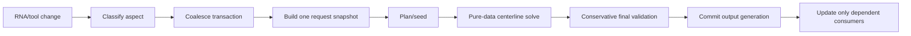

# Fiber performance audit

- Status: audit plus staged implementation; corrected V1 is usable, V2 remains rollout-gated
- Audit date: 2026-08-13
- Runtime measured: Blender 5.0.1, factory-startup background process
- Workloads: synthetic collision scaling scenes and `E:\development\WIP_models\skull_muscles.blend`
- Scope: Fiber creation, synchronization, routing, collision/refinement, progressive recompute, and curve proxy output. Fiber Surface is only covered where it is a downstream consumer of Fiber changes.

## Executive conclusion

Release status by stage:

| Stage | Current status | Gate result |
| --- | --- | --- |
| 1. Runtime amplification | Substantially implemented | Debounce, targeted routing, nested draining, request-local quality, telemetry, selection, thickness, touch batching, and load suppression pass focused gates; 24-Fiber sync remains above 1 s |
| 2. Correctness/lifecycle | Substantially implemented | World collision, authored pins, exact validation/replay, stale publication guards, scoped/bounded caches, and cancellation/load/history lifecycle tests pass; production conservative CCD is still absent |
| 3. Pure-data engine | Partial | Planner, iteration, acceptance, and validation work are resumable and initialization passes; Blender-bound state plus atomic BVH work still cause occasional slices above 20 ms |
| 4. Banded Solver V2 | Core implemented, integration failed gate | O(N) factorization, scaling, and immediate provisional preview pass; 512-node latency, warm/cold agreement, and full-scene gates remain open |
| 5. Collision/rollout | Development reference only | A disabled conservative sweep reference passes adversarial tests but is too slow; no production CCD backend was adopted and V2 stays opt-in |

### Implementation checkpoint - 2026-08-13

Stage 1 and the correctness/lifecycle portion of Stage 2 are substantially implemented. Aspect-aware/debounced requests,
display-only thickness, nested request draining, request-local quality, world-space collision math,
localized owner contact, exact authored pins/counts, bounded evaluated-geometry/factor caches, and
lifecycle invalidation are present. Bounded per-request telemetry now records queue/run and phase
timings, solves, iterations, BVH queries, writes, cache bytes, and progressive slice distributions.
Exact cache replay is revalidated, and provisional or stale outputs are excluded from consumers.
Planner seeds remain soft: a valid refined curve is preserved, and a seed is restored only as an
exactly revalidated fallback for an unsafe or nonfinite candidate.
Solver-property, handle, Quick Fiber, and explicit Recompute requests now draw the captured anchor
route immediately as a transient preview before validated refinement. That preview changes neither
persisted point JSON nor exact caches or downstream output generations.

The V2 quadratic core is also implemented with an O(N) pentadiagonal LDLT solve for open Fibers
and a rank-3 Woodbury correction for loops. At 512 nodes its cached factor uses 16.0 KiB open or
40.1 KiB cyclic, and a warm global solve is about 2.8-3.0 ms. Migration remains explicit and
atomic, with a persisted legacy rollback snapshot and a Restore Legacy Shape action.

V2 is not cleared for rollout. After exact-query reuse, removal of a redundant voxel precheck, and
invalid-start corrections, cold production `FIBER_14` measures 43.93 ms at 64 nodes, 242.56 ms at
256, and 479.76 ms at 512. All three converged with zero measured penetration and matched the
pre-optimization output bit-for-bit. The 256-to-512 ratio is 1.98x and passes the scaling gate, but
512 nodes remains above 220 ms. The raw 64-node solve is 43.93 ms, while the separate provisional
preview initializes within one frame. The core factor is not the bottleneck. New Fibers therefore
still default to solver version 1 unless the explicit development
rollout flag is enabled.

V2 qualification proves both controls monotonic on a clear fixture: increasing length weight
strictly shortens the path, while increasing curvature weight strictly reduces curvature. Converged
64/128 results differ by 6.26e-5 after arc resampling (below 0.1 collision radius) and path length by
2.65e-8. Hard pins pass the scene-scale tolerance and factor-cache cold/warm output is bit-exact.
The full iterative warm-seed path remains a rollout blocker: it differs from cold output by about
2.07e-5 against the roughly 1e-6 scene tolerance under the current stopping/min-iteration policy.

The corrected 24-Fiber interactive sync remains above its gate at roughly 1.20 s. Targeted selection
now measures about 0.68 ms median / 0.87 ms p95, and thickness-only mutation about 0.03 ms; both run
zero solver iterations and no downstream rebuilds. Twenty solver-property events and a 20-touch
transaction each produce one targeted request. Load hydration fell from roughly 10.0 s and 96 solves
to 0.54-0.71 s and zero solves while retaining all 24 persisted proxies. A 101-pair alternating
probe measured telemetry overhead at 0.14%, below the 2% gate.
Progressive initialization now passes at about 3 ms. Repeated-run slice p95/max are not yet reliably
below their 12/20 ms targets, proving that atomic BVH/materialization work still violates the
intended deadline.

Stage 3 now has stable tokens, a deque-backed refinement queue, a resumable visibility-graph
planner, and exact-order microbatches for smoothing, point/edge contacts, rollback, line search,
acceptance, safe-snapshot work, and final validation. On `FIBER_14` N64, initialization fell from
about 81 ms to roughly 3 ms, and progressive output matches the corrected synchronous V1 result
exactly. Direct-open
`FIBER_13` and cyclic `FIBER_15` also match exactly. After microbatching acceptance and final
validation, repeated runs measure about 9 ms median, 9.72-15.85 ms p95, and 14.42-26.34 ms maximum.
Cold BVH materialization and individual queries still produce occasional overruns. The session also still retains Blender objects;
the immutable pure-data request/state contracts are not yet the production owner of solver state.

The final post-integration fresh-process sample measured 4.87 ms initialization, 9.04 ms median,
13.34 ms p95, and 19.85 ms maximum. This single run passes the maximum but not the 12 ms p95 gate;
the repeated range above remains the release decision because cold BVH work is variable.

IPC Toolkit was researched but not bundled: current wheels bring SciPy, platform coverage gaps,
and a transitive filib licensing/build review. A disabled pure-data conservative CCD reference now
covers adversarial sweeps, but costs about 543 ms by itself at 512 nodes, so it is a qualification
oracle rather than a production backend.

### Baseline audit evidence (pre-implementation)

The detailed findings below preserve the measured baseline and the reasoning that drove the staged
changes. Where a baseline statement conflicts with the checkpoint above, the checkpoint records the
current implementation status.

The dominant measured implementation problem is a concrete quadratic defect in collision filtering, not Blender mesh write speed and not the route planner. A deeper mathematical audit found an equally important design problem: the operations exposed as shortening/stretch stiffness and bend stiffness are algebraically identical Laplacian averaging steps. The current solver is therefore a collision-pushed curve-shortening heuristic, not a solver with independent length and curvature objectives. It should not be ported verbatim to C++, a GPU, XPBD, or another package.

`FiberSolver._owner_zone_limits()` is called once per node and repeatedly per segment. Before it can hit its per-iteration cache, it builds a key containing every node coordinate. This makes one apparently cached lookup O(node_count), called O(node_count) times in several passes. At 512 nodes, this key path consumed about 9.58 of 10.39 profiled seconds and executed roughly 9.5 million `round()` calls.

Three multipliers make that defect substantially worse:

1. An explicit empty collider list is treated as if no collider argument was supplied. Owner/AABB filtering can produce `()`, after which the collision oracle performs a new active-collider query and may reintroduce colliders that were deliberately excluded.
2. Those high-cardinality active queries are stored in an unbounded scene-global cache. One isolated 512-node solve added 1,140 cache entries.
3. Every Fiber property uses the same synchronous solve callback. A thickness-only edit on a 128-node test Fiber spent 882 ms recomputing the solver even though only curve bevel depth needed to change.

In `skull_muscles.blend`, one interactive direct solve of all 24 Fibers takes about 2.60 s, while the actual Fiber sync takes about 6.37 s because three Fibers retain bake preference. Temporarily forcing those Fibers to interactive quality reduces the same sync to 2.48 s. A thickness edit costs 257-1,667 ms through the current callback, while the equivalent bevel-only mutation costs 0.032-0.039 ms in a disposable process. Curve writes themselves are sub-millisecond.

The production run also exposed a correctness constraint: loop-cache signatures omit bend stiffness, shortening stiffness, and iteration count. Those edits can return stale points in about 4 ms and overwrite prior non-convergence diagnostics with false zero-error/converged values. Cache correctness must be fixed before increasing reuse.

The first optimization pass should separate interactive and bake policy, split visual-only property updates, repair cache/diagnostic correctness, remove the quadratic key construction, fix `None` versus empty collider semantics, and stop globally caching per-node active queries. Once those behavior-preserving defects are measured and locked down, the recommended core is an explicit static centerline objective with independent length and bending terms plus a conservative collision-free step. XPBD is appropriate only if Fiber is intended to be a physical dynamic rod. Package substitution is a targeted later pilot, not the first move.

## Priority summary

Evidence labels: **M** measured/reproduced, **C** directly proven from code, **R** credible risk that still requires a focused reproduction.

| Rank | Severity/evidence | Weak point | Why it leads |
| ---: | --- | --- | --- |
| 1 | P0 C/M | Bend and shortening are the same Laplacian update | The solver has no independent length/curvature model; tuning and convergence are ambiguous |
| 2 | P0 M | Local BVH distances use world margins under scaled objects | Production colliders have extreme/non-uniform/negative scales, so clearance is wrong now |
| 3 | P0 C/M | Cache/final diagnostics can describe stale or rejected geometry | Loop edits return false convergence; only 1/24 stored penetrations matched post-output recheck |
| 4 | P0 C/R | Mid-touch and loop owner contacts are not modeled | Legal attachment contact can be classified as penetration and make convergence impossible |
| 5 | P0 M | Owner-zone key construction creates O(iterations × nodes²) work | It owns most high-node runtime; temporary structural variants show large gains |
| 6 | P0 M/C | Every property and nested child edit over-invalidates synchronously | Thickness can cost 1.67 s for a 0.03 ms visual change; touch callbacks can request full syncs |
| 7 | P0 C | Empty collider sets re-query global colliders | Excluded owner colliders return, geometry/diagnostics change, and cache keys proliferate |
| 8 | P0/P1 M | Progressive work is not time bounded | Nominal 12 ms slices reached 39 ms after up to 89 ms synchronous initialization |
| 9 | P0 C/R | Global caches/output generations have incomplete lifecycle | Undo/load/delete/recreate can retain stale RNA/results and downstream proxies |
| 10 | P0 C/R | Surface guides/anchor counts can violate node-count contracts | A 64-node request can expand toward a full surface route or lose loop pins |
| 11 | P1 C/R | Fixed samples/rays are neither robust sign nor CCD | Thin/concave/open geometry and moving edges can be misclassified or tunnel |
| 12 | P1 C | Nested runtime work can be silently dropped | Downstream Muscle fallback can fail inside the normal outer pass |

Implementation order must follow dependency order, not just this rank: fix signatures/lifecycle, coordinate/contact/final-state correctness, then eliminate structural waste, then replace the numerical model and collision guard.

## Runtime map

### Normal property or dependency update

1. Fiber RNA update callback in `properties/vcp_properties.py` calls the runtime synchronously.
2. Runtime graph expands the dirty Fiber to Fiber Surface, Muscle, Blob, Soft Tissue, and mirror dependents as applicable.
3. `FiberSyncDriver` calls `FiberSceneSync.sync_root_to_scene()` for affected Fibers.
4. The sync path forces a view-layer update, builds a visualization object index, and calls `FiberSolver.solve_points()`.
5. The solver resolves attachment anchors, creates a `CollisionOracle`, optionally creates surface guides/planner seed points, then runs multilevel refinement.
6. The result rewrites or reuses the curve proxy and updates cached Fiber points.
7. Downstream sync drivers rebuild consumers of the Fiber result.

Relevant entry points:

- `properties/vcp_properties.py:119` - `_on_fiber_prop_update`
- `core/deps/builtin_drivers.py:168` - `FiberSyncDriver`
- `core/visualization/fiber_sync_runtime.py:138` - `_sync_single_fiber`
- `core/vcp/fiber_solver.py:151` - `solve_points`
- `core/visualization/fiber_sync_helpers.py:262` - `update_curve_points`

### Manual recompute

1. `recompute_fiber()` calls `request_fiber_refinement()`.
2. `request_fiber_refinement()` synchronously creates and initializes a progressive solve session.
3. Anchor resolution, collider snapshot creation, route planning, and the first level setup happen before the request returns.
4. A Blender timer advances the session in nominal 12 ms slices.
5. Each slice runs at least one complete solver iteration, even when that iteration greatly exceeds 12 ms.
6. Preview geometry can be applied every 50 ms; final completion sends a `FIBER_SOLVE_READY` dependency event.

Relevant entry points:

- `core/visualization/fiber_refinement.py:57` - `request_fiber_refinement`
- `core/vcp/fiber_progressive.py:94` - `begin_fiber_solve`
- `core/vcp/fiber_progressive.py:211` - `_step_until_deadline`
- `core/visualization/fiber_refinement.py:142` - `_flush_one`

## Measurements

These are diagnostic measurements, not release benchmarks. They were run in clean Blender background processes against the current worktree, with one cube blocker, 12 interactive iterations, surface routing disabled, and warm start disabled for the custom scaling cases. The lower-node cases in the first process can benefit from already-created scene caches. The isolated 512-node result is listed separately. `cProfile` materially increases absolute time, so profiled results are used for attribution rather than target latency.

### Interactive scaling

| Nodes | Segment collision off | Segment collision on |
| ---: | ---: | ---: |
| 32 | 47.17 ms | 85.39 ms |
| 64 | 67.28 ms | 181.10 ms |
| 128 | 148.35 ms | 413.65 ms |
| 256 | 454.54 ms | 1,291.50 ms |
| 512 | 1,384.36 ms | 5,131.97-5,633.54 ms |

The 256-to-512 segment-collision result grows by approximately 4x, matching the quadratic key behavior found in the profile. The toggle-off result is still slow because safe-snapshot validation forcibly enables segment clearance checks.

### Focused profiles

#### Existing blocked-route workflow

Test: `FiberVcpWorkflowTests.test_recompute_fiber_roadmap_mode_detours_around_blocker`

- Total profiled test time: about 3.01 s.
- Progressive refinement: about 2.86 s cumulative.
- Route planning: about 30 ms cumulative.
- Function calls: about 8.28 million.
- `_owner_zone_limits()` path: about 1.40 s cumulative in this default-sized scenario.
- `CollisionOracle.push_out_point()`: about 0.95 s cumulative.
- 16,389 voxel signed-distance requests and 18,001 exact signed-distance samples were observed.

The simple cube planner used 44 roadmap nodes and 946 visibility-pair checks. Planning is not the first bottleneck in this measured case.

#### Isolated 512-node solver

- Unprofiled wall time: about 5.13 s.
- Profiled time: about 10.39 s.
- Function calls under `cProfile`: about 29.83 million.
- `_owner_zone_limits()`: 8,159 calls, 9.58 s cumulative.
- `_owner_zone_key()`: 9.08 s cumulative.
- `_nodes_key()`: 9.06 s cumulative.
- `_point_key()`: 3.09 million calls, 8.08 s cumulative.
- `round()`: about 9.52 million calls, 3.09 s self time.
- Segment rollback: 6.92 s cumulative, mostly nested owner-zone/key work rather than unique collision math.

The owner-zone/key numbers are cumulative and overlap; they must not be added together. They show that key creation dominates the solve.

#### Visual-only property update

Changing only `fiber.thickness` on a 128-node, segment-collision test Fiber took about 882 ms under `cProfile`. The call path went directly from `_on_fiber_prop_update()` through dependency sync into `FiberSolver.solve_points()`; about 850 ms was refinement. This work is architecturally unnecessary for a bevel-only change.

### Cache growth

After one isolated 512-node solve:

- Scene-cache entries grew from 94 to 1,234: +1,140 entries.
- 1,219 keys contained `fiber_active`.
- Those key strings alone contained about 495,129 characters, excluding Python object overhead and cached values.

`clear_scene_cache()` exists, but there are no production call sites. The cache is neither bounded nor cleared on load/undo/scene deletion in the inspected code.

## Production workload: `skull_muscles.blend`

### Safety and reproducibility

- Source: `E:\development\WIP_models\skull_muscles.blend`
- Size: 17,607,672 bytes
- SHA-256 before profiling: `A7C4033AB2EB7479EAEC4A069CB1D7DDF9FECC5D5C43037863B02A9F9BB7EF06`
- SHA-256 after the complete disposable test pass: unchanged (`A7C4033AB2EB7479EAEC4A069CB1D7DDF9FECC5D5C43037863B02A9F9BB7EF06`)
- The file was opened with `--background --factory-startup` and was never saved. Every parameter edit and monkey-patched experiment existed only in a disposable Blender process.
- The reusable runner is `tools/fiber_perf_probe.py`. It inventories, solves, syncs, profiles, tests visual-only edits, measures collider materialization, and runs isolated temporary variants. Every function in the runner is at most 15 lines.
- Add-on load handlers perform a full runtime sync while the file opens. The solve numbers below therefore represent post-open interactive use with some scene assets warm, not a disk-cold geometry build.

### Scene inventory

| Item | Count / setting |
| --- | ---: |
| Scene objects | 175 |
| Object types | 78 mesh, 61 curve, 31 empty, 2 lattice, 1 armature, 1 camera, 1 light |
| SCPs / geometry colliders | 19 / 19 |
| Fibers / Muscles | 24 / 12 |
| Fiber Surfaces / Blobs / Soft Tissues | 0 / 0 / 0 |
| Fiber proxy objects | 48, including mirrored proxies |
| Primary Fiber topology | 21 open, 3 loop |
| Node / interactive / bake settings | all 64 / 12 / 180 |
| Surface routing / segment collision | 4 enabled / 0 enabled |
| Warm start | enabled on all 24 |
| Persistent bake preference | FIBER_10, FIBER_18, FIBER_24 |
| Authored touches | 0-7 per open Fiber |
| Loop anchors | 11, 16, and 20 |

Evaluated collider payloads total 15,460 vertices and 30,544 triangles. A Fiber activates 2-11 colliders in this scene, mean 5.96. Building all 19 bounds records costs about 0.97 ms. Materializing every surface payload costs about 43.46 ms total; the Ear is the largest contributor at 21.57 ms. This makes collider discovery/materialization secondary in this average-complexity file, though it can grow with production mesh density.

### End-to-end latency

| Operation | Wall time |
| --- | ---: |
| Direct interactive solves, all 24, cold solver caches | 2,596.82 ms |
| Actual Fiber sync, all 24, persistent bake preference honored | 6,368.76 ms |
| Same actual sync, bake preference disabled in memory | 2,482.33 ms |
| Targeted FIBER_10 sync, preference honored / ignored | 1,525.19 / 106.19 ms |
| Targeted FIBER_24 sync, preference honored / ignored | 1,402.12 / 92.71 ms |
| Current thickness property callback, FIBER_14 | 256.65-295.90 ms |
| Current thickness property callback, FIBER_10 / FIBER_24 | 1,667.15 / 1,605.09 ms |
| Disposable bevel-only thickness path | 0.032-0.039 ms |

The all-Fiber sync is 2.57x faster when stale bake preference is ignored. This is a policy improvement rather than a numerical solver optimization. Bake remains appropriate for an explicit final-quality action; it should not silently determine the quality of the next ordinary property refresh.

The bevel-only experiment updates one primary proxy and is not a production patch. A real visual-only driver must update mirrored proxies and any display consumers, but this adds tiny object-write cost rather than solver iterations or Muscle rebuilds.

### Dependency fan-out for one property edit

With runtime tracing enabled, a FIBER_14 thickness change expanded one dirty Fiber to two Fibers and two Muscles. The 295.37 ms runtime divided as follows:

| Driver / phase | Time | Share |
| --- | ---: | ---: |
| Fiber sync | 206.32 ms | 69.9% |
| Muscle sync | 69.70 ms | 23.6% |
| Mirror sync | 17.47 ms | 5.9% |
| Graph, constraints, and other sync | about 1.88 ms | 0.6% |

Individual curve writes in that trace were 0.29-0.39 ms. The expensive work is solving both impacted Fibers and rebuilding downstream Muscles, not writing the curve.

The automatic full load sync took 471.12 ms in the traced process: attachment-capture constraints 140.73 ms, Muscle sync 208.58 ms, mirror sync 53.05 ms, SCP sync 40.54 ms, and Fiber sync 25.74 ms. Stored proxies and warmed payloads make this load profile different from an explicit full recompute.

### Production cProfile attribution

`cProfile` increases absolute time; cumulative entries overlap and must not be added.

| Fiber | Profiled wall | Refinement | Main cumulative paths |
| --- | ---: | ---: | --- |
| FIBER_14, open, 5 active colliders | 225.89 ms | 224.59 ms | safe snapshot 115 ms; collision apply 97 ms; segment clearance 92 ms; push-out 85 ms; owner-zone/key 78 ms |
| FIBER_22, open, surface routing, 9 active | 290.07 ms | 279.61 ms | push-out 145 ms; safe snapshot 128 ms; owner-zone/key 82 ms |
| FIBER_17, loop, 20 anchors, 11 active | 134.56 ms | 115.60 ms | collision push-out 92 ms; first-use surface materialization 22 ms; anchor resolution 17 ms |

At 64 nodes, owner-zone key creation already consumes roughly 28-35% of these profiled open-Fiber solves. Push-out and mandatory safe-snapshot segment validation take most of the remainder. Planner work is small in this file: FIBER_10 bake planning is 33.21 ms inside a 1,685.06 ms solve, and FIBER_22 segment-collision planning is 2.66 ms inside 457.60 ms.

### Node and iteration scaling on real geometry

Both representative open Fibers use 12 interactive iterations:

| Nodes | FIBER_14, 5 active | FIBER_22, 9 active |
| ---: | ---: | ---: |
| 32 | 54.98 ms | 72.99 ms |
| 64 | 117.39 ms | 137.59 ms |
| 128 | 274.43 ms | 319.52 ms |
| 256 | 729.43 ms | 730.37 ms |
| 512 | 2,343.92 ms | 2,222.92 ms |

A 16x node increase produces about 30-43x latency, confirming superlinear behavior on the supplied scene. FIBER_14 also grows from 12 to 76 scene-global `fiber_active` keys as nodes increase.

FIBER_14 at 64 nodes scales with requested iterations as follows:

| Iterations | Wall | Max displacement | Max penetration | Converged |
| ---: | ---: | ---: | ---: | --- |
| 1 | 48.77 ms | 0.0067215 | 0.0522432 | no |
| 4 | 48.01 ms | 0.0067215 | 0.0522432 | no |
| 8 | 91.43 ms | 0.0005774 | 0.0331769 | no |
| 12 | 117.01 ms | 0.0003091 | 0.0315969 | no |
| 24 | 205.17 ms | 0.0001239 | 0.0290573 | no |
| 60 | 480.83 ms | 0.0000548 | 0.0271681 | no |
| 120 | 1,014.98 ms | 0.0000437 | 0.0261495 | no |
| 180 | 1,920.04 ms | 0.0000406 | 0.0256985 | no |

The multilevel schedule creates a practical floor, so 1 and 4 requested iterations cost the same and produce the same result. Above that floor, cost is roughly proportional to the iteration budget, but this Fiber still does not converge at 180 iterations. Across one fresh interactive solve of all 24 Fibers, 23 report non-convergence; only FIBER_13 converges. Cached loop results can falsely reduce the reported count, as described in F-13.

### Bake quality versus cost

| Fiber | Interactive wall | Bake wall | Interactive / bake penetration | Result |
| --- | ---: | ---: | ---: | --- |
| FIBER_10 | 102.76 ms | 1,685.06 ms | 0.0009000 / 0.0009000 | both non-converged |
| FIBER_18 loop | 66.42 ms | 389.42 ms | 0.0017998 / 0.0017998 | both non-converged |
| FIBER_24 | 83.08 ms | 1,416.66 ms | 0.0010669 / 0.0010673 | both non-converged |

Bake reduces displacement, but it does not improve penetration for these three persistent-preference Fibers and remains non-converged. FIBER_24 penetration is marginally worse in the measured bake. This does not prove that bake is globally useless; it proves that automatically paying 6-17x for ordinary edits is not justified by these workload results.

### Feature and warm-cache behavior

On FIBER_22:

| Surface routing | Segment collision | Wall | Planner | Penetration |
| --- | --- | ---: | ---: | ---: |
| on | off | 144.75 ms | 0.00 ms | 0.0021375 |
| off | off | 136.81 ms | 0.00 ms | 0.0021375 |
| on | on | 457.60 ms | 2.66 ms | 0.0011739 |
| off | on | 462.57 ms | 1.82 ms | 0.0011739 |

Surface routing costs about 8 ms here and does not change the final result. Enabling segment collisions costs about 3.2x, lowers penetration by about 45%, and still does not converge. Refinement, not the planner, owns this increase.

Open-Fiber warm start has little latency effect: FIBER_14's second solve is 110.69 ms with warm start and 113.16 ms without it. FIBER_17 loop falls from 63.32 ms to 2.98 ms on a warm cache, but this fast path also erases the real non-convergence diagnostics and ignores several solver parameter edits. It is not a valid optimization result until F-13 is fixed.

### Temporary optimization experiments

No experiment below was written into production code.

| Target | Baseline | Hoist owner zones once per point-push pass | Explicit-empty fix | Both |
| --- | ---: | ---: | ---: | ---: |
| FIBER_14 | 126.36 ms | 78.91 ms | 98.39 ms | 68.87 ms |
| FIBER_22 | 132.92 ms | 91.66 ms | 133.26 ms | 110.10 ms |

The owner-zone hoist produced identical points for these two targeted cases and saved 31-38%. The explicit-empty fix changed FIBER_14 by at most `1.69e-7` units while correcting its reported penetration from `0.031597` to `0.0`; it had no effect on FIBER_22 because that solve did not exercise the empty-filter fallback.

Across all 24 Fibers in fresh processes:

| Variant | Total solve wall | Speedup | Max point delta | Changed points / 1,536 | Scene cache / active keys |
| --- | ---: | ---: | ---: | ---: | ---: |
| Baseline | 2,525.98 ms | 1.00x | 0 | 0 | 473 / 398 |
| Hoist owner zones | 1,526.33 ms | 1.66x | 0.002683 | 287 | 705 / 630 |
| Hoist plus explicit-empty semantics | 1,337.40 ms | 1.89x | 0.012680 | 741 | 144 / 69 |

The all-scene geometry differences mean the naive hoist is not safe to merge even though it is fast. Owner-zone boundaries currently change as nodes are pushed. The production implementation needs explicit state generations or a documented pass-level snapshot, followed by collision-clearance equivalence tests. The explicit-empty correction intentionally changes incorrect fallback behavior and cuts active-query cache keys by about 83%; its new geometry must be validated as the desired semantics.

Repeatedly solving an unchanged FIBER_14 ten times does not continue growing the cache because bounds keys repeat. Real edits and diverse Fibers do: one pass over the 24 distinct paths creates 398 active-query keys. These entries remain globally retained with no production invalidation call.

### Progressive-solver responsiveness

Manual Fiber recompute uses bake parameters and synchronously constructs anchors, collider records, route planning, and the first solve level before its timer job is queued. The extended probe measured both that initialization and every nominal 12 ms timer slice:

| Fiber | Synchronous initialization | Slices | p50 / p95 | Worst slice | Slices over 12 ms | Slice total |
| --- | ---: | ---: | ---: | ---: | ---: | ---: |
| FIBER_10, open, 2 touches | 32.90 ms | 70 | 18.62 / 22.93 ms | 30.77 ms | 69 / 70 | 1,247.05 ms |
| FIBER_14, open | 88.56 ms | 102 | 18.44 / 23.19 ms | 39.01 ms | 102 / 102 | 1,866.71 ms |
| FIBER_17, loop, 20 anchors | 13.87 ms | 21 | 12.83 / 14.87 ms | 14.90 ms | 20 / 21 | 267.43 ms |

The timer does not preempt Python. It checks the deadline only between whole iterations, and guarantees that at least one iteration runs. The nominal budget therefore describes when the next iteration may begin, not a maximum UI block. FIBER_14 also retained a Python-visible lower-bound estimate of 11.34 MB in the scene-cache graph after this one job; FIBER_10 retained 11.62 MB, including 191 active-query keys. C-level BVH and Blender allocation sizes are not included.

### Final-output diagnostic re-evaluation

The probe solved all 24 Fibers, then re-evaluated the emitted points with the current collision oracle while forcing the same mandatory segment-safety mode used by safe snapshots. This is not an independent exact collision proof: it deliberately inherits the present ray/sample method and the present owner-exclusion model. It is useful for testing whether stored diagnostics describe the geometry actually returned.

- Only FIBER_13 had stored maximum penetration equal to the post-output value.
- FIBER_14 returned a segment-clear path after restoration but retained `0.0315969` as its maximum penetration.
- FIBER_20 similarly returned clear under the current re-check but retained `0.0008996`.
- 21 of 24 outputs were not strictly segment-clear under the current all-applicable-collider model. Many failures are near authored attachments and therefore also expose the incomplete owner-contact model in F-16; they must not be interpreted as 21 independently proven visible intersections.
- Loop FIBER_15 re-checked at `0.04980` segment penetration while storing `0.00390`; FIBER_17 re-checked at `0.06042` while storing `0.12841`.

The core conclusion is unambiguous: `eps_pen` is an attempted-step correction magnitude, not a residual of the final emitted geometry. Safe/seed restoration can change every point after that value is computed.

### Transform-scale collision reproduction

The collision BVH is local-space, but the clearance and margin are treated as if local units equal world units. A disposable synthetic test used a unit cube object scaled uniformly to `0.1` with a requested world margin of `0.02`:

| Query | Correct world result | Current result |
| --- | ---: | ---: |
| Point 0.01 world units outside surface | signed distance 0.01; still 0.01 short of margin | signed distance 0.10; treated clear |
| Point 0.01 world units inside surface | push to 0.02 world clearance; correction 0.03 | push to 0.002 world clearance; reports correction 0.12 |

This is not hypothetical for the production file. Collider object scales include `[0.55, 0.10, 0.063]`, `[0.0816, 0.0216, 0.0816]`, `[0.1246, 0.2638, 0.1452]`, approximately `[0.011, 0.011, 0.011]`, non-uniform scale `1.195` on Cranium, and a negative scale around `-0.0172`. The current local-space distance, ray length, margin, and normal correction cannot be correct across those transforms.

### Geometry-stamp mutation check

A same-count vertex mutation was performed only in memory in disposable processes and then restored. `_collider_stamp()` remained unchanged, confirming that its data-pointer/vertex-count/matrix signature cannot observe the edit. In these specific Blender evaluations, the evaluated mesh pointer used by `_surface_stamp()` changed, so the cached surface payload was rebuilt and no stale BVH was observed. This narrows, but does not remove, the risk: collider-record and progressive-job stamps are demonstrably incomplete, while the surface payload happened to invalidate through evaluated-pointer churn. Modifier, shape-key, and same-pointer cases still need explicit generation tests.

## Ranked findings

### F-01 - P0 - Owner-zone cache lookup is O(nodes squared)

Locations:

- `core/vcp/fiber_solver.py:906` - `_pair_colliders`
- `core/vcp/fiber_solver.py:912` - `_node_colliders`
- `core/vcp/fiber_solver.py:945` - `_owner_zone_limits`
- `core/vcp/fiber_solver.py:966` - `_owner_zone_key`
- `core/vcp/fiber_solver.py:1009` - `_nodes_key`
- `core/vcp/fiber_solver.py:1149` - `_apply_collision_constraints`
- `core/vcp/fiber_solver.py:1165` - `_rollback_segment_introductions`

`_owner_zone_limits()` caches its result in the per-iteration collision context, but `_owner_zone_key()` serializes every point in `nodes` before the dictionary lookup. `_apply_collision_constraints()` invokes it indirectly for each free node. Rollback invokes it for the before and after state of every segment. A cache hit therefore still costs O(nodes).

Recommended direction:

- Compute owner-zone limits once per immutable state used by a phase and pass them into node/segment filtering.
- Give the per-iteration state a small generation/token key instead of reconstructing all coordinates.
- In rollback, compute zones once for `prev_nodes` and once for `nodes`, then reuse them for every pair.
- Keep all new or modified functions at 15 lines or fewer.

Expected impact: this is the most likely source of an order-of-magnitude improvement at 256-512 nodes. A temporary pass-level hoist saved 31-38% on two production Fibers at 64 nodes and 39% across all 24, but the naive full-scene variant changed some points. Preserve the current dynamic owner-zone semantics or intentionally redefine and test them; do not copy the monkey patch directly.

### F-02 - P0 - Empty collider filters fall back to global queries

Locations:

- `core/vcp/fiber_collision.py:29` - `colliders`
- `core/vcp/fiber_collision.py:39` - `segment_visible`
- `core/vcp/fiber_collision.py:43` - `segment_hit_samples`
- `core/vcp/fiber_collision.py:51` - `push_out_point`

The oracle uses expressions such as `colliders or self.active_colliders_for_polyline(...)`. This conflates two different meanings:

- `None`: the caller did not provide a collider set; query it.
- `()`: the caller filtered the set and explicitly determined that no collider is applicable.

When owner-zone or AABB filtering returns empty, the oracle re-queries active colliders for the point/segment. This defeats filtering, can reintroduce an endpoint-owner collider, and creates many unique global active-cache entries. The `colliders()` property has the same sentinel bug: an empty built list is rebuilt on every call because `[]` is false.

Recommended direction: use `is None` consistently. Add real-oracle regression tests for explicit empty lists; the current same-owner planner test uses a fake oracle and does not cover this behavior.

Production evidence: on the full 24-Fiber pass, combining correct empty semantics with the owner-zone experiment reduced retained active-query keys from 398 to 69. FIBER_14's reported penetration changed from `0.031597` to `0.0` with only a `1.69e-7` maximum point delta, showing that the fallback can reintroduce an excluded collider into diagnostics/narrow phase.

### F-03 - P0 - Property invalidation is too coarse and synchronous

Locations:

- `properties/vcp_properties.py:119` - all Fiber scalar properties use `_on_fiber_prop_update`
- `properties/vcp_properties.py:9` - touch/loop child updates use `_sync_vcp_scene`
- `app/use_cases/fiber_tools.py:173` - touch creation assigns two callback properties without a suppression guard
- `core/visualization/fiber_sync_runtime.py:138` - every affected Fiber is solved before curve update

Name, thickness, muscle assignment, topology, node count, solver stiffness, and attachment changes all take the same synchronous path. There is no debounce for Fiber property edits. A thickness edit recomputes points; a name edit can also fan out to downstream entities.

Touch child properties are worse: `_sync_vcp_scene()` passes empty dirty hints, which the runtime normalizes to a full update. Adding one touch assigns `parent_id` and `attach_param`, so it can request two full dependency-runtime passes and then one explicit targeted Fiber pass. Multi-touch creation scales this duplication with the number of selected points.

Recommended direction:

- Classify Fiber changes into visual-only, solver-only, attachment/topology, and relationship changes.
- Visual-only thickness/color/name changes should update only the proxy or UI.
- Solver parameters should schedule/coalesce an interactive solve rather than block every slider event.
- Guard batch touch/anchor mutations and send one targeted dirty event afterward.
- Child update callbacks must identify the owning Fiber and never use empty dirty hints for ordinary edits.

Production evidence: a thickness edit took 257-296 ms on FIBER_14 and 1.61-1.67 s on persistent-bake Fibers. A disposable bevel-only path took 0.032-0.039 ms. Runtime tracing attributes the FIBER_14 edit to two Fiber solves (206.32 ms), two Muscle updates (69.70 ms), and mirror work (17.47 ms); the curve writes were below 0.4 ms each.

### F-04 - P0/P1 - Scene cache is unbounded and receives per-state keys

Locations:

- `core/utils.py:3` - `_SCENE_CACHE`
- `core/utils.py:18` / `:23` - all keys are stringified on get/set
- `core/vcp/fiber_collision.py:162` - active-collider cache lookup
- `core/vcp/fiber_collision.py:184` - active key embeds bounds and every collider stamp
- `core/vcp/fiber_collision.py:457` - voxel payload cache
- `core/vcp/fiber_collision.py:526` - shell-node cache

Stable, expensive assets such as collider surfaces, shells, and voxel data are reasonable scene-cache candidates. Per-point/per-polyline active queries are not: their bounds change with solver state, producing many long-lived keys with little cross-solve reuse. Stringifying tuple keys adds construction, hashing, and memory cost.

Recommended direction:

- Keep high-cardinality broad-phase query caches local to one solve or one iteration.
- Use bounded LRU storage if cross-solve reuse proves useful.
- Use structured compact keys rather than `str(tuple)`.
- Clear Fiber cache generations on scene load, undo/redo, geometry changes, object removal, and add-on unregister.
- Expose cache size/hit/miss counters in the performance harness.

Production evidence: one interactive pass over 24 64-node Fibers retains 473 scene-cache entries, 398 of them active-query keys. The explicit-empty experiment cuts active-query keys by about 83%, but query caching should still be solve-local or bounded because new edited paths create new bounds keys.

### F-05 - P1 - Progressive refinement does not enforce its time budget

Locations:

- `core/vcp/fiber_progressive.py:75` - `FiberSolveSession.step`
- `core/vcp/fiber_progressive.py:211` - deadline is checked only around `_step_open`/`_step_loop`
- `core/visualization/fiber_refinement.py:22` - nominal slice is 12 ms

The loop always runs at least one full iteration. At large node counts, one iteration can take hundreds of milliseconds, so the Blender UI still freezes even though the job is timer-driven. Initialization and route planning also happen synchronously inside `request_fiber_refinement()` before a job is queued.

Recommended direction:

- Make initialization/planning a scheduled phase.
- Split one solver iteration into resumable node, segment, acceptance, and snapshot chunks.
- Check the deadline inside large node/edge loops.
- Use a lower-resolution immediate preview and progressively increase resolution.
- Track actual maximum slice duration, not only accumulated refinement time.

### F-06 - P1 - Collision validation repeats the same state work

Locations:

- `core/vcp/fiber_solver.py:669` - iteration loop
- `core/vcp/fiber_solver.py:706` - candidate step
- `core/vcp/fiber_solver.py:754` - safe snapshots force segment collisions on
- `core/vcp/fiber_solver.py:772` onward - candidate, backtrack, sweep, path, and state checks
- `core/vcp/fiber_solver.py:1149` onward - point push, segment penalty, rollback

One iteration can perform point pushes, segment penalties, before/after rollback penetration, candidate segment checks, moved-point checks, start-state checks, three sweep states, backtracking states, and post-iteration safe-snapshot checks. The per-iteration context helps some exact duplicates, but it is recreated each iteration and several phases use slightly different state coordinates.

`_snapshot_segments_clear()` unconditionally turns segment collisions on. This is a valid safety intent, but it means the UI toggle does not remove the segment-clearance cost. The 512-node toggle-off benchmark still took about 1.38 s.

Recommended direction:

- Build one collision-evaluation record per candidate state and reuse its active colliders, owner zones, per-node penetration, per-edge hits, and maximum penetration.
- Run narrow-phase work only for broad-phase candidates.
- Revalidate unchanged edges/nodes by generation rather than position-tuple reconstruction.
- Define separately what the segment-collision toggle controls and what mandatory final safety validation controls.
- Consider coarse safety checks per iteration and exact checks on acceptance/finalization.

### F-07 - P1 - Collider records are rebuilt for every Fiber solve

Locations:

- `core/vcp/fiber_solver.py:160` / `:181` - new `CollisionOracle` per solve
- `core/vcp/fiber_collision.py:81` - scan all scene objects and create records
- `core/scp_runtime/surface.py:138` - surface payload itself is scene-cached
- `core/scp_runtime/surface.py:235` - one materialization eagerly builds two BVHs, face centers, and a route graph

Full BVH/surface payloads are reused when their stamps hit, which is good. However, each Fiber still scans `scene.objects`, evaluates bounds for every geometry SCP, copies matrices, creates stamps, and sorts collider records. A batch update of many Fibers repeats this setup once per Fiber.

The shared surface payload is also broader than the collision query requires. First materialization always constructs local and world BVHs, face centers, and the full adjacency graph used by surface routes. A collision-only Fiber primarily needs the local BVH, bounds, and limited shell source data. On high-poly cold caches, eager route-graph and second-BVH construction may become a major first-use cost even though it was negligible for the cube benchmark.

Recommended direction: create one immutable collision snapshot per scene/depsgraph geometry generation and share it across all Fibers in the same sync batch. Keep solve-local query caches separate, and materialize route/attachment capabilities lazily rather than as one all-or-nothing surface payload.

Production evidence: all 19 collider bounds records build in about 0.97 ms and all surface payloads materialize in about 43.46 ms for 30,544 evaluated triangles. Sharing snapshots is worthwhile but is not a top-order win for this file compared with the 2.60 s interactive solve total.

### F-08 - P2 - Planner builds a complete visibility graph

Locations:

- `core/vcp/fiber_planner.py:100` - roadmap construction
- `core/vcp/fiber_planner.py:143` - all node pairs are checked
- `core/vcp/fiber_collision.py:291` - a clear visibility check may ray-test and sample five interior points

Sparse roadmaps are capped at 96 nodes and dense roadmaps at 240. A dense complete graph has 28,680 candidate pairs per authored segment. Each candidate is tested against active colliders. If a segment ray is clear, the current visibility test samples five points; a signed-distance sample can issue a nearest query plus two sign rays.

The measured cube case planned in only about 30 ms because it used 44 nodes and 946 pairs. This is a potential worst-case hotspot, especially with multiple colliders or authored touch segments, but it ranks behind the proven solver defects.

Production evidence supports that rank: FIBER_10 bake planning is 33.21 ms of 1,685.06 ms, and FIBER_22 segment-collision planning is 2.66 ms of 457.60 ms.

Recommended direction after P0 work:

- Measure production high-poly/concave scenes.
- Replace the complete graph with spatial neighbors plus start/goal visibility edges.
- Grow the roadmap lazily if A* cannot connect the goal.
- Reuse visibility results across sparse/dense attempts and authored segments.

### F-09 - P2 - Avoidable Blender API and proxy-output work

Locations:

- `core/utils.py:75` - `scene_for_id()` uses `Object.users_scene`
- `core/utils.py:85` - `depsgraph_for_scene()` forces `ViewLayer.update()`
- `core/visualization/fiber_sync_runtime.py:172` - every sync requests that dependency graph, including selection refresh setup
- `core/visualization/fiber_refinement.py:317` - manual recompute also forces a view-layer update
- `core/visualization/fiber_sync_helpers.py:238` onward - signature, point cache, spline rewrite, and JSON ID-property output

The curve writer correctly uses `foreach_set()`, which should be retained. However, preview output still formats an SHA-1 signature, serializes all points to JSON, stores a second Python tuple copy, clears/recreates the spline when changed, and can do this at 20 Hz. `scene_for_id()` is called multiple times and Blender documents `Object.users_scene` as O(number of scenes times number of objects). Forced view-layer updates can become material in a complex production scene even though they were small in the microbenchmarks.

Recommended direction:

- Pass `scene` and `depsgraph` through established runtime context instead of rediscovering/updating them.
- Do not force a dependency update for selection-only refresh.
- Avoid JSON ID-property serialization for transient previews; commit durable output at completion.
- Reuse an existing spline when the point count is unchanged, and keep bulk `foreach_set()` writes.

Blender references consulted:

- [Blender 5.0 Object API](https://docs.blender.org/api/5.0/bpy.types.Object.html)
- [Blender 5.0 Mesh API](https://docs.blender.org/api/5.0/bpy.types.Mesh.html)
- [Blender BMesh API](https://docs.blender.org/api/current/bmesh.html)

### F-10 - P1 correctness constraint - Existing cache stamps are under-specified

Locations:

- `core/vcp/fiber_collision.py:128` - collider stamp is data pointer, vertex count, and matrix
- `core/scp_runtime/surface.py:109` - surface stamp is data pointer, mesh counts, and matrix
- `core/vcp/fiber_solver.py:230` - loop solve cache signature

Coordinate edits or modifier changes that preserve data pointer/counts/matrix may reuse stale bounds, BVHs, voxel payloads, or shell nodes. Loop result-cache invalidation and diagnostics are expanded separately in F-13.

Performance optimization will increase cache reuse, so invalidation must be made explicit first. Prefer a dependency-graph geometry generation/version owned by the runtime over hashing every vertex on every query.

### F-11 - P0/P1 - Persistent bake preference turns ordinary edits into bake solves

Locations:

- `core/visualization/fiber_sync_runtime.py:143` - a bake sync stores `af_prefer_bake = True`
- `core/visualization/fiber_sync_runtime.py:144` - later syncs use bake if the flag remains true
- `app/use_cases/fiber_create.py:60` / `:76` - loop creation requests bake sync

Attachment/touch tools clear the flag, but ordinary scalar property callbacks do not. A loop Fiber created with bake preference can therefore use `iterations_bake` for later name, thickness, stiffness, or node-count edits. This combines with F-03 to make interactive edits unexpectedly expensive.

Recommended direction: remove persistent bake preference from normal update selection, or clear it for every solve-affecting edit and keep final-quality state separate from the next requested quality mode.

Production evidence: disabling bake preference in memory reduces a full sync from 6,368.76 to 2,482.33 ms. FIBER_10 falls from 1,525.19 to 106.19 ms and FIBER_24 from 1,402.12 to 92.71 ms. Their bake solves remain non-converged and do not improve penetration in the measured file.

### F-12 - P2 - Diagnostics are not granular enough

The runtime can time whole dependency drivers, collider builds, surface builds, planner time, refinement time, and curve writes when tracing is enabled. It does not expose:

- owner-zone/key time;
- active broad-phase queries and cache hit rate;
- node push versus segment ray/sample time;
- rollback, acceptance, sweep, and snapshot time;
- actual maximum progressive slice duration;
- scene-cache size and growth;
- cold versus warm surface/BVH behavior.

The normal synchronous Fiber path also does not consistently store end-to-end recompute time in the Fiber runtime diagnostics. Optimization should begin with a deterministic benchmark harness and phase counters so improvements cannot move cost into an unmeasured stage.

### F-13 - P0 correctness - Loop cache ignores solver parameters and falsifies diagnostics

Locations:

- `core/vcp/fiber_solver.py:220` - `_solve_loop_nodes`
- `core/vcp/fiber_solver.py:233` - `_cached_loop_result`
- `core/vcp/fiber_solver.py:244` - `_loop_cache_signature`

The loop signature contains only `node_count`, `segment_collisions`, and resolved anchor coordinates. It omits at least bend stiffness, shorten/stretch stiffness, interactive/bake iteration budget, margin/clearance inputs, and solve quality mode. On a cache hit, `_solve_loop_nodes()` returns the old points with `converged=True`, `max_disp=0.0`, `max_pen=0.0`, and `active_count=0`, then the normal status path overwrites the previous real diagnostics.

Production reproduction on FIBER_17:

| Edited field after a real solve | Second call | Max point delta | Reported result |
| --- | ---: | ---: | --- |
| `bend_stiffness` | 4.19 ms | 0 | converged, zero displacement/penetration |
| `stretch_stiffness` | 4.15 ms | 0 | converged, zero displacement/penetration |
| `iterations_interactive` | 4.33 ms | 0 | converged, zero displacement/penetration |
| `use_segment_collisions` | 944.03 ms | 0.019655 | cache invalidated, non-converged |

The first real solve took 59-72 ms and was non-converged. The fast 4 ms calls are stale-result returns, not successful incremental solves.

Recommended direction:

- Define one complete immutable solver-input signature shared by open and loop cache policy.
- Include quality mode and every field that can affect points; exclude truly visual-only fields such as thickness once F-03 is split.
- Store and replay the cached diagnostics with the points, or preserve the prior real diagnostics on an exact cache hit.
- Add tests that change every Fiber property individually and assert whether points must change, the cache must invalidate, and downstream entities must rebuild.
- Treat this as a correctness prerequisite for any broader cross-Fiber or cross-frame cache reuse.

### F-14 - P0 design correctness - Bend and shortening are the same operation

Locations:

- `core/vcp/fiber_solver.py:116-126` - open iteration order
- `core/vcp/fiber_solver.py:288-317` - cyclic equivalents
- `core/vcp/fiber_solver.py:1122-1142` - `_apply_length_shortening` and `_apply_bend_smoothing`

Both open functions compute the same update:

`x[i] = lerp(x[i], (x[i-1] + x[i+1]) / 2, strength)`

The cyclic `additive=False` and `additive=True` expressions are also algebraically identical. Shortening runs every iteration and bend runs again on even iterations. There is no edge rest length, distance constraint, independent curvature energy, material frame, or compliance. As a result:

- the two UI controls do not represent independent quantities;
- changing iteration count changes effective stiffness;
- even iterations apply two Laplacian contractions and odd iterations apply one;
- the fixed point is governed by pins, collision push-out, rollback, and averaging order rather than a documented objective;
- “convergence” cannot establish that a named stretch or bend energy was minimized.

This is a likely root cause of the parameter ambiguity and 23-of-24 non-convergence baseline. It is not merely a performance implementation detail.

Recommended direction:

1. Decide the product meaning. The existing behavior most closely describes a static collision-free display centerline, not a dynamic anatomical rod.
2. For a static centerline, define explicit independent terms, for example edge/length regularization `D1` and curvature `D2`, hard attachment pins, and collision/contact constraints.
3. Solve the smooth open-chain part with a tridiagonal/pentadiagonal local-global system. Its factorization is reusable by node count, cyclic state, pin mask, and weights; a chain-specific band solver is O(nodes).
4. If Fiber is intended to carry physical rest length, elasticity, dynamics, or twist, replace the heuristic with XPBD distance/bending constraints or a rod formulation instead. Do not introduce XPBD only as a speed patch.
5. Add isolation tests: at zero bend weight, only length behavior changes; at zero length weight, only curvature behavior changes; changing iteration count must not redefine the requested stiffness.

Research basis: [XPBD](https://matthias-research.github.io/pages/publications/XPBD.pdf) explains why ordinary PBD stiffness depends on timestep and projection count and introduces compliance; [Projective Dynamics](https://users.cs.utah.edu/~ladislav/bouaziz14projective/bouaziz14projective.html) uses local projections with a reusable global solve; [Discrete Elastic Rods](https://www.cs.columbia.edu/cg/rods/index.html) is relevant only if twist and physical rod behavior are real requirements.

### F-15 - P0 collision correctness - Local and world units are mixed under object scale

Locations:

- `core/vcp/fiber_collision.py:91-99` - collider transforms
- `core/vcp/fiber_collision.py:364-387` - signed distance and ray limit
- `core/vcp/fiber_collision.py:425-442` - nearest push-out
- `core/vcp/fiber_collision.py:475-477` - voxel bounds conversion

The BVH is built from local vertices. World points are transformed to local space, but the world-space `margin` is compared directly with local distances and added along a local normal. `_ray_sign()` derives a ray length from world AABB bounds and passes it into a local-space ray cast. The stored `m3` is unused; normals are not transformed with the inverse transpose. Under non-uniform scale, a local nearest point is not necessarily the world-metric nearest point.

The disposable scale reproduction above proves both false clearance and under-correction. Because production colliders have strong non-uniform, small, and negative scales, every collision result and convergence metric is suspect until this is fixed.

Recommended direction:

- Establish one canonical world-space clearance contract.
- Correctness-first option: build/query a world-space BVH per geometry-plus-transform generation.
- Optimized rigid-transform option: reuse local BVH only for rotation/translation; compute world hit points/distances and inverse-transpose normals. Non-uniform scale still needs a correct world metric or a world BVH.
- Make negative determinant/orientation behavior explicit.
- Add uniform scale `0.01/0.1/1/10`, non-uniform scale, rotation, shear if supported, and negative-scale equivalence tests.
- Test both nearest distance and the final achieved world clearance, not only whether a push occurred.

### F-16 - P0 collision-model correctness - Authored attachment ownership is incomplete

Locations:

- `core/vcp/fiber_solver.py:383-395` - open anchors retain each owner
- `core/vcp/fiber_solver.py:582-585` - only first and last owners enter solver params
- `core/vcp/fiber_solver.py:933-979` - owner-zone filtering models only two end zones
- `core/vcp/fiber_solver.py:220-230` and `core/vcp/fiber_progressive.py:113-121` - loop path never adds owner zones
- `core/vcp/fiber_solver.py:324-331` - cyclic point collision uses all active colliders
- `core/vcp/fiber_planner.py:70-79` - same-owner planning removes the whole owner collider

Every midpoint touch is an authored contact on an SCP, but only the first and last owner IDs are represented in `endpoint_owners`. Pinned touch nodes and adjacent segments can therefore be classified as penetrating the very surface to which they are intentionally attached. Loop anchors retain owner IDs in `PlannerAnchor`, but cyclic refinement supplies no local owner-zone model at all. This can make convergence mathematically impossible near legal contacts and explains why strict loop re-checks report large penetration.

The planner applies the opposite over-correction: when both ends share an owner, it removes that collider completely. A direct chord through the interior of the owner can then be accepted. Legal contact needs a bounded exemption near the attachment, not global removal of the obstacle.

Recommended direction:

- Represent attachment exclusions as explicit per-pin contact records: owner ID, node index or arc interval, permitted side, and trim radius/arc length.
- Apply the same contact model to open endpoints, open mid touches, and loop anchors.
- Exempt only the local owner neighborhood needed to leave/arrive at a pin; all other segments must still collide with that owner.
- Separate “legal attachment contact” from “inside solid” and “clearance shell.”
- Add multi-touch, same-owner open, mixed-owner open, many-anchor loop, concave owner, and endpoint-inside recovery tests.
- Re-run convergence only after this model exists; current non-convergence counts combine solver weakness with potentially unsatisfiable constraints.

### F-17 - P0 output correctness - Restoration can violate pins and diagnostics describe rejected states

Locations:

- `core/vcp/fiber_solver.py:572-580` - `_restore_seed_if_needed`
- `core/vcp/fiber_solver.py:685-721` - final restore paths
- `core/vcp/fiber_solver.py:723-757` - safe snapshots
- `core/vcp/fiber_progressive.py:275-304` - progressive completion and metric storage

`_restore_seed_if_needed()` resamples the original route and copies every point over the final nodes without restoring hard pin targets. A touch point can therefore move after the iteration loop. The planner seed contains authored points, but resampling does not guarantee that they land on the same node indices.

Safe-snapshot restoration has three related defects:

1. It validates/restores using the last state's active-collider list, not a collider set recomputed around the snapshot being considered.
2. Safe candidates are ranked only by path length, with no clearance margin, curvature, or pin-error criterion.
3. Stored `max_disp`/`max_pen` are captured before safe/seed restoration. Point push-out returns the correction applied, not the residual after correction. The emitted path can be clear with a large stored penetration or colliding with a smaller stored value.

If no safe snapshot exists, the function can still return a colliding non-converged curve instead of a distinct hard failure/fallback state.

Recommended direction:

- Centralize finalization: restore candidate, restore every hard pin, recompute active colliders for that exact candidate, validate final node/segment clearance, compute final residuals, then commit.
- Store both iteration diagnostics and final-output diagnostics with explicit names.
- Require a valid final state for `CONVERGED`; expose `NO_FEASIBLE_PATH`, `FALLBACK_UNSAFE`, or similar when no safe candidate exists.
- Rank safe snapshots with a documented lexicographic objective: feasibility, pin error, clearance, then length/curvature.
- Add output-level assertions for exact attachment pins and truthful metrics after every restore path.

### F-18 - P0 contract correctness - Requested node count is not a bound

Locations:

- `core/vcp/fiber_solver.py:397-406` - surface guides
- `core/vcp/fiber_solver.py:587-615` - level and output node counts
- `core/scp_runtime/surface.py:292-317` - full vertex-path output
- `core/vcp/fiber_solver.py:250-261` and `core/vcp/fiber_loop.py:37-45` - loop resampling/pins

Open `_build_level_nodes()` silently raises `node_count` to `len(anchors)` or `len(guide_worlds) + 2`. A surface graph route can contain hundreds or thousands of vertices; Cranium evaluates to 7,938 vertices in the supplied file. An authored request for 64 nodes can therefore become a very large solve, exploding both refinement cost and output cardinality.

When all authored anchors share one owner, `_level_pin_targets()` uses every surface-route guide as a hard pin rather than a seed or soft guide. A dense route can therefore both expand the solve and remove most or all degrees of freedom.

Loop nodes remain at the requested count even when the number of loop anchors exceeds it. Multiple hard anchors then have to map to the same or insufficient indices, creating overwritten/unsatisfiable pin targets. Downstream Fiber Surface and Muscle code often assumes the authored `fiber.node_count`, so silent output-size changes can also violate consumer topology assumptions.

Recommended direction:

- Make `node_count` an explicit output contract.
- Resample/simplify surface guide paths to a capped guide budget before building levels; preserve endpoints and topology-changing turns.
- Keep authored attachments as hard pins but treat computed route guides as seed points or documented soft constraints.
- Require `node_count >= hard_pin_count` or raise it visibly in authored data, never only in a local solver variable.
- Reject or explicitly auto-increase impossible loop configurations before solve.
- Return actual output count in the result and validate all downstream consumers against it.
- Stress test long high-poly geodesics and anchors equal to `N-1`, `N`, and `N+1`.

### F-19 - P1 collision correctness/performance - Fixed sampling is not CCD

Locations:

- `core/vcp/fiber_collision.py:342-357` - one ray crossing and five spatial samples
- `core/vcp/fiber_collision.py:380-397` - inside/outside heuristic
- `core/vcp/fiber_solver.py:779-860` - candidate, sweep, and node-path checks
- `core/vcp/fiber_solver.py:1026-1030` - three temporal sweep samples
- `core/vcp/fiber_solver.py:1215-1259` - three base segment samples plus first ray hit

Static segment clearance combines a single ray hit with fixed interior samples. Candidate motion checks three interpolated states and a finite set of node paths/backtracking alphas. Thin blockers, concavity, fast motion, and penetration between sample locations can be missed. `_ray_sign()` declares a point inside when both +X and -X rays have any hit; it does not count intersection parity. The fallback nearest-normal sign assumes consistent outward normals. This is fragile for open, disconnected, non-manifold, intersecting, or negatively scaled anatomical proxies.

`_candidate_clear()` also skips continuous sweep validation when the starting state is invalid: after confirming the candidate itself is clear, a failed `_candidate_start_clear()` returns `True`. Escape from penetration is useful, but accepting an arbitrary path through other geometry is not a documented recovery guarantee.

Recommended direction:

- First repair start-state recovery semantics and final validation.
- Pilot a conservative maximum collision-free step for Fiber edges against static collider triangles. IPC Toolkit exposes `compute_collision_free_stepsize(..., min_distance=...)`, supports codimensional edges, and allows pair filtering; this can replace temporal samples and repeated fixed backtracks without adopting the full IPC optimizer.
- IPC requires an initially intersection-free state, so planner/depenetration still has to establish a valid seed.
- If a custom kernel is preferred, use swept AABBs plus robust segment/edge/triangle continuous distance tests.
- For SDF sign generation or validation, evaluate generalized/fast winding numbers rather than the one-hit ±X heuristic.

Primary references: [IPC Toolkit CCD](https://ipctk.xyz/python-api/ccd.html), [IPC Toolkit CPython wheels](https://pypi.org/project/ipctk/), and [generalized winding numbers](https://igl.ethz.ch/projects/winding-number/). IPC Toolkit is MIT-licensed; wheel packaging, Blender extension licensing, pair-filter overhead, and all supported platforms require an explicit pilot.

### F-20 - P1 solver semantics - Iteration and convergence settings are not honored literally

Locations:

- `core/vcp/fiber_solver.py:595-602` - multilevel split
- `core/vcp/fiber_solver.py:663-667` - per-level minimum
- `core/vcp/fiber_solver.py:669-704` - convergence checks
- `core/vcp/fiber_solver.py:97-100` - open warm start
- `core/vcp/fiber_solver.py:1334-1354` - polyline resampling

`_split_iterations()` allocates at least one iteration to every multiresolution level. When requested iterations are lower than the number of levels, it executes more work than requested; this is why 1 and 4 iterations produced identical time and points. `_iteration_converged()` receives a zero-based iteration index and tests it against `min_iters`, effectively requiring one additional iteration. `_blocked_clear()` can label a zero-alpha, low-penetration state converged without requiring a small displacement residual.

Open warm starts have no complete input signature. They still iterate, unlike the loop fast path, but stale geometry/attachment/settings can seed a different local minimum. `_resample_polyline()` performs a fresh linear span search for every output point, O(source_count × target_count), even though target arc lengths are monotonic.

Recommended direction:

- Define whether iteration count is total work, finest-level work, or a maximum; enforce and display that exact contract.
- Use one-based completed-iteration counts consistently.
- Make convergence a final-state residual test, not a blocked-step shortcut.
- Key warm starts by a complete solve generation and retain a deterministic cold-bake mode.
- Make resampling O(source + target) with a monotonic cursor or O(target log source) binary search.

### F-21 - P2 planner quality/scaling - Complete graphs and weak shell samples

Locations:

- `core/vcp/fiber_planner.py:86-118` - roadmap population/truncation
- `core/vcp/fiber_planner.py:143-156` - complete visibility graph
- `core/vcp/fiber_planner.py:193-246` - shortcut and relaxation checks
- `core/vcp/fiber_collision.py:526-600` - shell samples

The dense planner checks up to 28,680 node pairs per authored segment, and each visibility query can touch multiple colliders. Every touch divides a Fiber into another independently planned segment; sparse/dense visibility results are not shared. Shell vertices are sampled by source order, globally truncated, and offset radially from their sampled centroid. Radial offset is not a valid outward normal on concave geometry. AABB corners/faces add coarse routes that can be long or graze obstacles.

When both roadmaps fail, the planner returns the known blocked direct segment as `LOCAL_FALLBACK`; refinement then spends its budget trying to recover from an invalid seed. Edge cost is length only, with no clearance penalty or hysteresis, so valid routes may skim surfaces and become numerically unstable.

This is real technical debt but not the current production bottleneck: measured planning is usually 2-33 ms versus hundreds or thousands in refinement.

Recommended direction after P0/P1 solver work:

- Use spatial k-nearest candidate edges and start/goal visibility rather than all pairs.
- Apply Lazy PRM: compute a candidate route, validate only its edges, remove failed edges, and repeat. The original method was designed to minimize expensive collision checks ([Lazy PRM](https://www.kavrakilab.org/publications/bohlin-kavraki2000path-planning-using.html)).
- Sample surface points by normals/farthest-point coverage and blocker relevance, not mesh vertex order.
- Include clearance in edge cost and expose planner failure instead of silently returning a blocked line.
- Reuse deterministic shell/roadmap assets by collider generation across Fibers and touch segments.

### F-22 - P1 responsiveness/correctness - Progressive job lifecycle is incomplete

Locations:

- `core/vcp/fiber_progressive.py:75-97` - step and initialization
- `core/vcp/fiber_progressive.py:211-245` - one whole iteration per slice
- `core/vcp/fiber_progressive.py:297-305` - metrics stored before final slice time is added
- `core/visualization/fiber_refinement.py:26-32` - queue policy
- `core/visualization/fiber_refinement.py:57-67` - synchronous job creation
- `core/visualization/fiber_refinement.py:142-175` - timer/apply path
- `core/visualization/fiber_refinement.py:207-269` - validity and geometry update
- `core/visualization/fiber_refinement.py:233-240` - incomplete Fiber signature
- `core/visualization/fiber_refinement.py:338-365` - undo/redo restart

In addition to the measured slice overruns:

- manual recompute always initializes bake parameters before yielding;
- the result can store `refine_ms` before the final slice duration is added;
- `_QUEUE` is a list using `pop(0)` and repeated linear removal;
- the job retains Blender RNA and depsgraph references across timer ticks;
- validity omits warm-start, preview, symmetry mode/axis/origin, root/scene identity generations, and newly added colliders;
- existing collider stamps miss same-count deformation;
- multiple jobs schedule about 12 ms of Python every 10 ms, so the main thread can remain continuously saturated;
- undo/redo automatically restarts paused expensive work rather than cancelling or waiting for idle/user intent;
- name-based scene/root/job keys fail on rename.

Recommended direction:

- Make planning, collider snapshot extraction, level creation, node passes, edge passes, candidate validation, and finalization resumable stages.
- Use a deque plus key membership set and an explicit aggregate main-thread budget.
- Keep stable session UIDs and authored/input revision numbers; do a cheap revision check per slice and a strong full check before commit.
- Snapshot pure inputs rather than relying on long-lived evaluated RNA objects.
- Cancel and mark dirty on history changes; restart only through explicit or idle policy.
- Record request-start latency, queue wait, maximum slice, p95 slice, cancellation cause, and stale-commit rejections.

### F-23 - P1 correctness/policy - Clearance, thickness, and model units are inconsistent

Locations:

- `core/vcp/fiber_solver.py:46-74` - fixed `0.002` margin/offset
- `core/vcp/fiber_collision.py:20-25` - clearance floor `0.01`
- `core/vcp/fiber_solver.py:212,483,1120` and `core/vcp/fiber_planner.py:62-63` - fixed corridor padding `0.05`
- `core/vcp/fiber_collision.py:445-523` - voxel construction/interpolation

Solver clearance is independent of visible Fiber thickness. A thick curve and a thin curve follow the same centerline and use the same `0.002` collision margin. This confirms that thickness can be treated as display-only without changing current behavior, but it also means visible geometry can intersect colliders even when its centerline passes the solver check. Product intent must decide whether collision radius should be `margin`, `thickness`, or a separate authored property.

The hard-coded values `0.002`, `0.01`, and `0.05` are raw world units with no scene/model scale contract. The planner/shell clearance can be five times the oracle floor and 25 times the solver margin. Unit changes can radically alter active collider sets and routes.

The lazy voxel cache compounds this:

- every axis is forced to at least 24 cells, even on thin geometry;
- values are individual Python dictionary entries;
- dimensions are tied to AABB span rather than clearance/error tolerance;
- outside-grid coordinates clamp the base cell but not the fractional coordinate, so trilinear interpolation extrapolates with fractions below 0 or above 1;
- sign samples inherit the local/world and ray-sign defects.

Recommended direction: document units, use one clearance/radius contract, derive tolerances from that contract and object scale, and either remove the voxel precheck or replace it with a contiguous, generation-owned narrow-band field whose error bound is smaller than the required clearance.

### F-24 - P1/P2 surface routing and payload are over-coupled

Locations:

- `core/scp_runtime/surface.py:225-246` - eager full payload
- `core/scp_runtime/surface.py:249-269` - Python route graph
- `core/vcp/fiber_solver.py:397-409` - only first and last authored segments receive surface routes
- `core/vcp/fiber_solver.py:418-440` - hard route acceptance ratios

One first-use surface payload always builds local and world BVHs, all face centers, all world vertices, and a Python adjacency graph. Collision-only queries do not need the second BVH, face centers, or route graph. Dense adjacency stored as dictionaries/lists/tuples also has high Python memory overhead.

Surface routing applies only to the first and last authored segments; every interior touch-to-touch segment is deliberately skipped. A computed geodesic is rejected if it is more than 1.5 times chord length or deviates by more than 0.5 times chord length—exactly the difficult geometry where a surface detour can be necessary. A raw vertex-edge A* path is then shortcut by free-space visibility, so the result is not necessarily constrained to remain on the surface despite the feature name.

Recommended direction:

- Split surface capabilities into lazy bounds, local/world nearest BVH, attachment data, shell samples, and route graph.
- Decide whether “surface routing” means surface-constrained, surface-initialized, or merely obstacle-aware; enforce one definition for every authored segment.
- Resample route output before solver levels as required by F-18.
- If repeated same-surface paths become important, the heat method can prefactor two sparse systems and answer new sources quickly; it is not a replacement for free-space routing. See [The Heat Method](https://www.cs.cmu.edu/~kmcrane/Projects/HeatMethod/).

### F-25 - P0 runtime correctness - Full, empty, selection, and nested requests have unsafe semantics

Locations:

- `core/deps/runtime_context_build.py:30-37` - empty or unrecognized dirty hints become full sync
- `properties/vcp_properties.py:9-12,237-245` - touch/loop child callbacks send empty hints
- `core/visualization/control_runtime.py:150-177` - selection enters dependency runtime
- `core/deps/builtin_drivers.py:174-304` - only Fiber driver consistently treats selection specially
- `core/visualization/sync_runner.py:46-57,314-317` - nested synchronous request returns without queuing
- `core/visualization/muscle_sync.py:134-147` - Muscle missing-points fallback makes a nested request

The runtime uses absence of recognized dirty IDs to mean “everything is dirty.” This is convenient for load/delete calls but dangerous for ordinary callbacks: an empty child hint or an ID removed between request and resolution becomes a full graph sync. A touch assignment writes both `parent_id` and `attach_param`, so the present callback path can request two full updates before the intended targeted solve.

Selection is nominally a display event. Fiber skips geometry solving for it, but downstream Fiber Surface, Muscle, Soft Tissue, and mirror drivers can still rebuild because the same dirty graph was expanded before driver dispatch.

Reentrancy has a correctness failure rather than only wasted work. `_run_request()` returns `False` while `_RUNNING`, but `sync_from_dirty_hints()` discards that return. Muscle's “solve missing Fiber points, then retry” fallback therefore performs no Fiber solve inside a normal outer runtime and immediately retries against the same missing data.

Recommended direction:

- Make full sync an explicit request flag/intent. Empty or invalid targeted sets must be no-op, not full.
- Resolve nested child ownership and emit one targeted structural Fiber request.
- Move selection/display state outside geometry propagation or make every geometry driver skip selection.
- Merge nested synchronous work into a bounded tail request drained after the outer pass; include a cycle guard and diagnostics.
- Test unknown/deleted IDs, selection, multi-touch writes, and Muscle fallback by counting actual solver/mesh writes.

### F-26 - P0 lifecycle correctness - Caches and downstream outputs can survive beyond their inputs

Locations:

- `core/utils.py:3-45` - global scene cache
- `core/deps/runtime_context_build.py:6,153-175` - global graph cache
- `core/scp_runtime/common.py:120-142,210-218` - cached object/property indexes
- `core/visualization/fiber_sync_helpers.py:217-235` - Fiber point cache
- `core/visualization/fiber_surface_sync.py:35-43` - failed evaluation retains old proxy
- `core/visualization/soft_tissue_source.py:94-119` - downstream source reads
- `core/deps/builtin_drivers.py:174-177` - load only refreshes Fiber selection

`clear_scene_cache()` and `clear_runtime_context_cache()` exist, but production code does not call them; only tests do. Pointer/name keyed entries can therefore retain RNA wrappers, geometry results, point arrays, and graph data across undo/redo, deletion/recreation, root replacement, and load. Pointer reuse can turn this from a leak into a stale-result hit.

Fiber Surface failure records an error but leaves its prior proxy mesh in place. Soft Tissue can consume that stale geometry without checking that its success/output generation matches the current source generation. Fiber-sourced Soft Tissue also reads only the volatile point cache; load refreshes Fiber selection rather than hydrating canonical Fiber results, so an immediately loaded downstream build can have no source even though a persisted proxy exists. Muscle has a JSON fallback, creating inconsistent consumer semantics.

Recommended direction:

- Add one lifecycle invalidator for load-pre, undo/redo pre and post, scene/root removal, unregister, and stable-ID replacement.
- Key scene-owned bounded caches by stable root/session UID and authored/output generations, not bare pointer/name.
- Create one canonical Fiber result reader used by Fiber Surface, Muscle, Soft Tissue, and mirrors; hydrate or validate it on load.
- Clear or mark failed proxies invalid and require downstream consumers to match a successful source output generation.
- Validate undo/delete/recreate-same-ID and reload against clean-recompute output hashes.

### F-27 - P1 update cost - Authoring is not transactional and aspects are not modeled

Locations:

- `properties/vcp_properties.py:119-122,248-299` - one Fiber scalar callback class
- `app/use_cases/fiber_tools.py:138-175` - multi-touch mutation
- `app/use_cases/muscle_create.py:126-158,204-209` - construction writes callback fields incrementally
- `app/use_cases/fiber_surface_create.py:97-108` - incremental source setup
- `app/use_cases/vcp_delete.py:174-179` and `core/visualization/delete_reconcile.py:205-225` - delete forces full sync

The dependency graph understands entity relationships but not change aspects. Metadata, display, centerline scalar, attachment, topology, ownership, selection, and bake policy all enter nearly the same entity-level invalidation. This produces callback storms during construction and makes cheap presentation edits rebuild derived geometry.

Specific multiplicative cases include:

- `2T` callback requests plus one explicit targeted request when adding `T` touches;
- repeated incomplete Muscle builds as callback-backed fields and Fiber references are assigned;
- setting `fiber.muscle_id` solving each Fiber even though ownership does not affect its centerline;
- final selection paths triggering additional downstream work;
- deleting one Fiber using empty hints to recompute every remaining Fiber.

Recommended direction: add a property-to-aspect table (`METADATA`, `DISPLAY`, `CENTERLINE`, `ATTACHMENT`, `TOPOLOGY`, `OWNERSHIP`, `BAKE_POLICY`), suppress callbacks across authoring transactions, increment structural generation once, and emit one aspect-aware request at commit. Delete reconciliation should clean indexes/proxies and dirty only actual dependents.

### F-28 - P1 integration performance - Request-wide Blender work is repeatedly rediscovered

Locations:

- `core/deps/runtime_context_build.py:94-175` - O(entity/edge) structural stamp on cache lookup
- `core/deps/runtime_graph.py:6-91` - port graph and SCC construction
- `core/deps/runtime_constraint_phase.py:63-66` and `runtime_sync_phase.py:65-69` - visit all drivers
- `core/utils.py:80-95` - forced view-layer update
- `core/visualization/fiber_sync_runtime.py:152-225` - object indexes, cleanup, handles, selection
- `__init__.py:372-383` plus per-feature modules - many depsgraph handlers
- `core/visualization/fiber_sync_helpers.py:238-291` - signature, copies, spline, JSON
- `core/visualization/vcp_mirror_runtime.py:203-216,313-352` - mirror rebuilds

A targeted request still builds a structural stamp across the authored graph, may build Tarjan SCC/port data unused by production drivers, visits every constraint/sync driver, forces one or more `ViewLayer.update()` calls, rebuilds object maps in multiple phases, and performs cleanup/highlight/handle scans. Roughly nine depsgraph handlers independently inspect updates and discover scene/root state. The scaling approaches O(handlers × updates) before entity-specific work.

Preview output then formats a SHA-1 signature, copies points into Python cache, recreates a spline, serializes JSON into an ID property, and may mirror-copy a new datablock at up to 20 Hz. The signature rounds to `1e-6` but the cache stores precise points before the signature decision; sub-threshold changes can make curve, cache, and JSON disagree.

Recommended direction:

- Use root-owned `graph_generation` and driver-registry generation rather than rebuilding full structural stamps on every hit.
- Lazily build diagnostic SCC/port structures; pre-index drivers by entity/aspect/intent and call `post_sync` only when involved.
- Create one request context with scene, view layer, depsgraph, update snapshot, collider snapshot, visualization object index, and output result cache.
- Consolidate depsgraph handlers behind one dispatcher that snapshots updates once and merges hints.
- Update selection colors/handles only for changed active IDs and compare before every RNA write.
- Make previews transient curve-only writes; persist canonical point output once at final commit and mirror only on source output-generation change.
- Use exact packed float bytes or one shared quantized representation for signature/cache/curve/persistence.

### F-29 - P0/P1 attachment correctness - Surface parameters lack topology identity

Locations:

- `core/attachment_codec.py:153-201` - decode/encode `surface_param_v2`
- `core/vcp/attachment_backend.py:47-126` - resolve and issue reporting
- `core/scp_runtime/surface.py:521-551` - frame from triangle indices/weights

`surface_param_v2` stores triangle vertex indices and barycentric weights, but `encode_fiber_surface_param()` stores no topology signature. If evaluated topology or vertex order changes while the old indices remain in range, the attachment resolves to a different triangle instead of invalidating. A topology-signature helper exists elsewhere, but this codec path does not persist/use it.

Recommended direction:

- Persist evaluated topology identity with the attachment plus a recovery payload such as parent/source-space point and normal.
- On mismatch, either invalidate explicitly or perform an explicit, user-visible rebind/reprojection; never silently reinterpret indices.
- Test reorder, subdivision, modifier change, and same-count topology changes by positional/normal error, not merely `resolve is not None`.

### F-30 - P1 collision correctness - Rollback and multi-contact projection are order-dependent

Locations:

- `core/vcp/fiber_solver.py:1165-1183` - rollback always chooses segment `b_idx`
- `core/vcp/fiber_solver.py:1297-1326` - endpoint correction and restoration
- `core/vcp/fiber_collision.py:403-442` - one sequential pass over colliders

When a newly colliding segment has pinned `b` and free `a`, rollback asks `_restore_iteration_node()` to restore `b`; the helper does nothing for a pin, so the collision is not rolled back. This is especially relevant for edges entering a midpoint or loop pin. Restoring only one endpoint can also introduce a problem in its other adjacent segment without immediate local revalidation.

Point push-out performs one sequential pass over colliders. Pushing out of collider B can re-enter collider A. Segment-sample corrections are summed from stale endpoints before being applied; opposing contacts can overshoot. Near `t=0` or `t=1`, pinned-end correction divides by values clamped only to `1e-6`, allowing very large moves. There is no explicit finite-value guard before nodes are committed/cached.

Recommended direction:

- Select a movable rollback endpoint based on pin state and actual displacement, then revalidate all adjacent edges.
- Prefer one conservative global step/TOI over local rollback when CCD is available.
- Use bounded iterative multi-contact projection with contact recomputation, or solve a small local contact problem.
- Add wedge/opposing-plane, pinned-A, pinned-B, both-free, cyclic-wrap, near-endpoint hit, and NaN/Inf containment tests.

### F-31 - P2 scope gap - Loop planning and inter-Fiber collision are undefined

Loop solving has no roadmap/surface planner comparable to the open path and no self-collision or Fiber-to-Fiber collision model. Closed paths shrink via the same duplicate Laplacian steps and collider projection. This can be acceptable if loops are author-defined rings allowed to cross themselves/other Fibers, but it must be an explicit product limitation. If self/inter-Fiber avoidance is required, add a broad phase over non-adjacent Fiber edges and define whether anatomical Fibers may intentionally overlap before selecting an elastic-band/XPBD closed-curve design.

### Runtime and downstream completeness matrix

The following secondary items are part of the same redesign and should remain in the regression plan even where they rank below the solver hot path:

| ID | Severity | Weak point | Required proof |
| --- | --- | --- | --- |
| I-01 | P0 | Empty/unknown dirty IDs escalate to full runtime | Unknown/deleted targeted ID causes zero unrelated solves |
| I-02 | P0 | Selection graph reaches downstream geometry drivers | Selection produces zero solver, mesh, and mirror geometry writes |
| I-03 | P0 | Nested synchronous runtime is silently dropped | Missing Fiber result is produced and consumed in one outer request |
| I-04 | P0 | Failed Fiber Surface leaves readable stale proxy | Invalid source cannot feed old geometry downstream |
| I-05 | P0 | scene/point/property/graph caches survive lifecycle changes | Undo/delete/recreate/reload equals clean recompute |
| I-06 | P0 | Fiber-sourced Soft Tissue lacks a persisted load fallback | Downstream works immediately after opening file |
| I-07 | P0 | refinement signature misses symmetry and same-count deformation | In-flight job cancels on every solve-affecting mutation |
| I-08 | P1 | slider RNA updates solve synchronously per event | Coalesced update count and p95 action latency |
| I-09 | P1 | touch creation emits `2T + 1` requests | One request regardless of touch count |
| I-10 | P1 | Muscle/Surface construction writes live callback fields | One committed build independent of field/ref count |
| I-11 | P1 | bake quality persists into later interactive edits | Bake followed by ordinary edit uses request-local quality |
| I-12 | P1 | graph cache hit still builds O(E) stamp | Context-hit latency independent of authored graph size |
| I-13 | P1 | SCC/port graph and all `post_sync` calls are eager | Only requested diagnostic/driver structures are built/run |
| I-14 | P1 | all drivers are visited on every request | Telemetry shows drivers considered/run is proportional to intent |
| I-15 | P1 | repeated forced `ViewLayer.update()` | zero for display/selection, at most one for geometry request |
| I-16 | P1 | many depsgraph handlers repeat update scans | one dispatcher snapshot and one merged scheduled request |
| I-17 | P1 | Fiber/Surface/Muscle/mirror rebuild object maps separately | one request-owned index; count scans |
| I-18 | P1 | highlight rewrites all Fiber styles | stable sync makes zero unchanged style writes |
| I-19 | P1 | handle helpers rediscover viewport and rewrite transforms | one viewport context and no-op transform checks |
| I-20 | P1 | preview duplicates/hashes/JSON-serializes points | transient preview writes curve only; track bytes/time |
| I-21 | P1 | rounded signature and precise cache can diverge | sub-micro edit has one canonical outcome everywhere |
| I-22 | P1 | progressive init and validity hashing remain synchronous | bounded request-start and slice latency |
| I-23 | P1 | jobs use names and undo auto-restarts | rename/history cannot stale-commit or surprise-restart |
| I-24 | P1 | Fiber Surface evaluated twice for Surface-to-Muscle chain | one evaluation per source/config revision in a request |
| I-25 | P1 | Muscle inflated path rebuilds topology and signatures | reuse base topology/faces; no-op material updates |
| I-26 | P1 | Soft Tissue scans scene and JSON-hashes full samples | generation-owned source sample and proxy index |
| I-27 | P1 | mirrors recreate data on non-geometry events | share datablock or copy only on output generation |
| I-28 | P1 | delete reconciliation recomputes unrelated Fibers | targeted cleanup with zero unrelated solves |
| I-29 | P2 | first-root/first-scene/first-view-layer assumptions | explicit single-root invariant or multi-root tests |
| I-30 | P2 | SCP index validates only scene object count | same-count retag/replacement invalidates index |
| I-31 | P2 | timer/list scheduling is scan-heavy and trailing-only | bounded max latency under continuous drag |
| I-32 | P2 | panel redraw performs linear nested entity lookup | one map build per draw/request |
| I-33 | P2 | runtime writes callback-backed attachment fields | suppressed callback plus authoritative outer intent |
| I-34 | P2 | clearing points stores an authoritative empty cache tuple | drop entry and increment invalid output generation |

## Secondary scaling observations

- `apply_selection_highlight()` scans every scene object.
- Collider discovery scans every scene object for every new oracle instead of using the existing SCP object index.
- Targeted Fiber sync still builds the visualization object index, scans for stale proxies/handles, and scans the scene for selection highlighting.
- Fiber dirty propagation intentionally rebuilds dependent Fiber Surfaces, Muscles, Blobs, Soft Tissues, and mirrors. Visual-only Fiber changes should not trigger that fan-out.
- Open-Fiber warm start is stored only in the process-local `FiberSolver` instance and does not have a full solve signature. It reduces initialization cost but does not address per-iteration complexity.
- Surface routing can build a full surface graph in the cached collider payload. This is justified for geodesic paths but should be lazy when no Fiber requests surface routing.
- Blender documents Python threads as unsupported for Blender API work. Do not attempt to hide these synchronous costs by touching RNA, evaluated meshes, or dependency graphs from worker threads. Process workers are viable only after extracting an immutable pure-data solve payload and accepting serialization/cancellation costs. See [Blender 5.0: Python Threads are Not Supported](https://docs.blender.org/api/5.0/info_gotchas_threading.html).

## Research-backed solution options

### Required product decision: static centerline or physical rod

The current behavior, data model, and consumers point toward a static authored centerline:

- no velocity, mass, timestep, gravity, rest pose, or twist state;
- inputs are attachment pins, touches, scalar smoothing strengths, and static colliders;
- output is immediately converted into a display curve and Muscle/Fiber Surface source;
- the desired visual behavior appears to be a short, smooth, collision-free path.

On that evidence, the default recommendation is a **static constrained centerline optimizer**. If Fiber must later simulate dynamic stretching, physical compliance, torsion, knots, or time evolution, that is a separate product requirement and should select XPBD or a discrete rod design deliberately.

### Solver viability matrix

Expected gains are engineering hypotheses for pilots, not measured promises.

| Approach | Likely value here | Integration/correctness cost | Verdict |
| --- | --- | --- | --- |
| Structural fixes to current runtime/solver | Highest immediate end-to-end gain; behavior-preserving parts already show 1.66-1.89x temporary speedups, and display-only edits improve by orders of magnitude | Low to medium; owner-zone changes need strict equivalence gates | P0, implement first |
| Explicit length plus curvature objective with banded local-global solve | Independent parameter meaning, reusable O(N) smooth solve, likely much fewer iterations | Medium; objective changes geometry and must define true length versus squared-edge regularization | Recommended P1 core architecture |
| Warm starts plus cached factorization/contact ordering | Large repeated-edit benefit when generations match | Medium; local-minimum/hysteresis risk, needs deterministic cold bake | Adopt after complete signatures |
| XPBD distance plus bending constraints | Correct compliance and iteration-independent stiffness semantics | Medium-high; needs rest lengths/timestep/physical meaning and may not be faster | Only if physical Fiber is required |
| Projective Dynamics/general local-global framework | Good conceptual basis for reusable global system | High if adopting a generic framework; contact active set remains dynamic | Use algorithmic idea, not a package rewrite |
| Chebyshev acceleration | Can accelerate a stable fixed-point method | Medium; unsafe around discontinuous contact until base iteration is well-defined | Experimental after rewrite |
| CHOMP-style trajectory optimization | Smoothness plus obstacle cost matches static routing conceptually | Medium-high; local minima and SDF gradient/error issues | Conditional P2 research |
| Direct stiff rods / Discrete Elastic Rods / Cosserat rods | Strong physical stretch/bend/twist behavior | Very high semantic and implementation cost | Reject unless twist/dynamics are requirements |

For a static open chain, a useful smooth model is

`E(x) = 0.5*w1*||D1*x||^2 + 0.5*w2*||D2*x||^2 + contact(x)`

where `D1` is the first difference and `D2` is the second difference. The smooth matrix is banded and can be factored once per node count/pin mask/weight generation, then solved for X/Y/Z in O(N). Hard pins split an open chain into spans. A loop needs a cyclic band solver or a cut at a pinned node. If exact arc length `sum(||D1*x||)` is required, use local projections or iterative reweighting rather than claiming the quadratic edge energy is exact length.

Primary algorithm references:

- [XPBD](https://matthias-research.github.io/pages/publications/XPBD.pdf)
- [Projective Dynamics](https://users.cs.utah.edu/~ladislav/bouaziz14projective/bouaziz14projective.html)
- [Discrete Elastic Rods](https://www.cs.columbia.edu/cg/rods/index.html)
- [The Heat Method](https://www.cs.cmu.edu/~kmcrane/Projects/HeatMethod/)
- [Lazy PRM](https://www.kavrakilab.org/publications/bohlin-kavraki2000path-planning-using.html)

### Collision viability matrix

| Approach | Expected effect | Main risk/cost | Verdict |
| --- | --- | --- | --- |
| Repair coordinate space, owner contacts, final residuals, and query reuse | Correctness prerequisite and likely largest query reduction | Requires new generations/contact model | P0 |
| Swept AABB plus robust segment/triangle distance/CCD | Removes fixed spatial/temporal samples | Native robust predicates and degeneracy handling | Strong P1 candidate |
| IPC Toolkit maximum collision-free step | Targeted replacement for three time samples and five backtracks; exact `min_distance` API | Must start collision-free; pair filtering and Python callback overhead need benchmark | Best external-package pilot |
| Shared contiguous SDF plus gradients | High point-query throughput across 24 Fibers | sign, resolution/error bound, memory, owner grouping/invalidation | P2 only if point push remains hot |
| Generalized/fast winding number | More robust sign on defective oriented meshes | expensive per scalar query; best amortized during field construction | Use for SDF build/validation |
| Incremental active contact ordering | Reduces repeated narrow-phase ordering work | cannot replace a conservative broad phase | Adopt as acceleration only |
| Object-level spatial index rewrite | Small benefit with only 19 collider objects | implementation/miss risk | Not a priority |
| Full IPC barrier/Newton optimizer | strong intersection-free framework | full solver rewrite and difficult attachment semantics | Do not adopt initially |
| Embree/OpenVDB/GPU BVH | Fast large-batch geometry queries | ABI, wheels, binary size, transfer and integration cost | Reject until profiles justify |

IPC Toolkit remains viable only as a contained experiment. Version 1.6 exposes conservative
collision-free step and minimum-distance APIs, codimensional edges, composable filters and a
parallel LBVH. CPython 3.11 wheels cover Windows x64, Linux x64 and macOS ARM64, but not macOS x64;
the wheel also declares SciPy, adding roughly 28-36 MiB per platform. Its default filib linkage
needs build/license inventory before distribution. A cached collision mesh can still hold fixed
anatomy faces plus moving Fiber edges and request `min_distance=clearance`, but production adoption
is blocked on packaging, platform, licensing and measured end-to-end gates. See the
[CCD API](https://ipctk.xyz/python-api/ccd.html) and [PyPI package](https://pypi.org/project/ipctk/).

### Execution/backend matrix

| Backend | Likely value | Limit | Verdict |
| --- | --- | --- | --- |
| Pure-Python structural redesign | Removes the largest proven waste and preserves easy Blender integration | scalar collision boundary remains | First |
| NumPy contiguous `N x 3` state | bulk state math and lower allocation overhead | at 64 nodes, conversions can exceed tiny arithmetic savings | Use once data stays contiguous end-to-end |
| Cython numeric/collision kernel | significant loop speedup with GIL-free pure data | platform wheels; no Blender API in `nogil` | Second native step after algorithms stabilize |
| pybind11/C++ combined solver plus CCD | highest low-latency native potential | build/ABI/platform maintenance | Long-term only |
| Persistent process pool | parallel independent multi-Fiber bake | Windows spawn, serialization/shared-memory lifecycle; bad for one edit | Batch bake only |
| Numba | good isolated JIT loops in theory | llvmlite/version/JIT footprint and not installed | Reject primary deployment |
| Warp/Taichi/CUDA | strong massive parallelism | tiny workload, JIT/device transfer/binary/hardware cost | Reject now |

Blender explicitly warns that persistent Python threads can crash and recommends multiprocessing only for work independent of Blender. A safe worker architecture must extract plain arrays on the main thread, never pass `bpy`, evaluated IDs, or `mathutils.BVHTree`, retain collider arrays in persistent worker/shared memory, validate a generation token on return, and commit curves on the main thread. Startup/IPC makes this inappropriate for a single 50-200 ms interaction. A native kernel that releases the GIL is better for interactive latency.

### Proposed target architecture



Recommended cache layers:

| Layer | Generation/key | Payload and lifetime |
| --- | --- | --- |
| Collider geometry | stable object UID plus geometry generation | local/world triangles and BVH/IPC faces; scene-owned, bounded |
| Collider transform | transform generation | matrices, normals, world bounds; invalidated independently |
| Route capability | geometry generation plus route settings | lazy adjacency/shell/geodesic factorization |
| Fiber topology | node count, cyclic state, exact pin mask, weights | band factorization |
| Fiber solution | exact anchor/collider/settings generations and quality | nodes, final diagnostics, contact ordering |
| Presentation | curve identity, output generation, point count | transient write buffers and final persisted result |

Every cache needs hit/miss/eviction telemetry, deterministic lifecycle clearing, and a memory bound. Cached contacts may order candidates but never replace conservative broad-phase validation.

### Packages and approaches not to adopt yet

- Do not translate the current duplicate Laplacian loop verbatim into C++, Cython, CUDA, or a GPU shader.
- Do not reduce nodes/iterations and call it optimization while 23 of 24 Fibers remain non-converged.
- Do not use dense `numpy.linalg.solve` for a banded chain.
- Do not add OMPL, Embree, OpenVDB, Numba, Warp, Taichi, or a GPU BVH before measured work can amortize them.
- Do not adopt full IPC, a generic physics framework, DER, or Cosserat rods for a static display centerline.
- Do not move Blender API work to threads or worker processes.
- Do not hash every collider vertex on every query as a substitute for explicit geometry generations.
- Do not increase cache reuse before lifecycle, signatures, and final-output correctness are fixed.
- Do not merge the temporary owner-zone hoist: its full-scene result changed geometry.

Blender extensions can bundle platform wheels, but all target wheels/dependencies/notices must be packaged and tested. IPC Toolkit's MIT license is permissive, while the add-on's distribution/licensing requirements still need a release review; this dossier is not legal advice.

## Optimization order

### Phase 0 - Freeze intent, measurement, and invariants

1. Decide static centerline versus physical rod, and whether thickness contributes to collision radius.
2. Keep `tools/fiber_perf_probe.py` machine-readable; store stable scenario manifests and results outside the production `.blend`.
3. Cover open/loop, endpoints/mid-touches, same/mixed owners, nodes 8-512, anchors around node-count limits, 0/1/8/32 colliders, uniform/non-uniform/negative scale, cold/warm, interactive/bake, surface routes, and segment collisions.
4. Add phase/query/write counters, request cause/aspect, cache bytes/hits/evictions, final residuals, and actual timer slice distributions.
5. Establish output invariants: exact pins, explicit output count, finite points, final-state clearance, truthful diagnostics, deterministic cold result, and no stale downstream generation.

### Phase 1 - Fix correctness before increasing reuse

1. Fix omitted versus explicit-empty collider semantics.
2. Replace incomplete loop/refinement/collider signatures with authored, geometry, transform, topology, symmetry, and quality generations; replay truthful cached diagnostics.
3. Make collision math world-correct under all supported transforms.
4. Introduce per-pin owner-contact semantics for endpoints, touches, and loops; stop globally removing same-owner colliders in planning.
5. Restore hard pins after every fallback, recompute active colliders for restored candidates, and compute final-output residuals before commit.
6. Make requested node count and hard-pin feasibility explicit; cap/simplify surface guides.
7. Add topology identity/recovery policy to attachment payloads.
8. Separate `BLOCKED`, `NO_FEASIBLE_PATH`, `UNSAFE_FALLBACK`, `NOT_CONVERGED`, and `CONVERGED`.

### Phase 2 - Remove proven structural and update waste

1. Remove persistent bake preference; quality is request-local.
2. Classify properties by aspect; thickness/name/selection perform no centerline or downstream geometry solve.
3. Suppress authoring callbacks and commit one targeted request per transaction.
4. Make full sync explicit; empty/unknown targets are no-op. Queue/drain nested runtime tail work safely.
5. Replace coordinate-rich owner-zone keys with explicit immutable state generations and pass computed zones through phases.
6. Keep high-cardinality active queries solve-local and bounded; clear every cache on lifecycle events.
7. Share one request context, collider snapshot, object index, evaluated depsgraph, and intermediate output generation across drivers.
8. Stop persistent JSON/mirror/datablock rewrites for transient previews and unchanged outputs.

### Phase 3 - Make UI work genuinely resumable

1. Turn anchor resolution, collider extraction, planning, level setup, node passes, edge passes, line search, snapshot validation, and finalization into resumable stages.
2. Enforce one aggregate main-thread deadline; no stage may guarantee a whole unbounded iteration.
3. Copy/apply preview points only at the draw throttle, not after every slice.
4. Use stable job UIDs and revisions; cancel on any solve-affecting input/history change and strong-check before commit.
5. Keep an immediate low-resolution preview path separate from explicit final bake.

### Phase 4 - Replace the ambiguous numerical core

1. Prototype the static banded length-plus-curvature objective against the corrected current solver.
2. Compare independent parameter response, node/iteration invariance, pin/clearance feasibility, convergence rate, determinism, and visual output on all 24 production Fibers.
3. Retain a cold deterministic reference solve and generation-valid warm factorization/solution caches.
4. If the product decision instead requires physical rods, prototype XPBD distance and bending constraints with explicit rest lengths/compliance rather than adapting the static objective silently.

### Phase 5 - Strengthen collision and planning only where profiles justify

1. Pilot IPC Toolkit maximum collision-free step on one representative open Fiber, one multi-touch Fiber, and one loop-contact case, then the full scene.
2. Compare exact/minimum clearance, owner filters, starting-penetration recovery, non-manifold/open meshes, repeatability, wheel deployment, and total query time.
3. If IPC is not viable, pilot a narrow native swept-segment/triangle kernel.
4. Add lazy sparse roadmap construction only after refinement/collision cease to dominate.
5. Consider SDF/heat-method assets only for repeated workloads with a defined error/memory budget.

### Phase 6 - Native and parallel execution, if still needed

1. Keep state as contiguous arrays and profile Python versus NumPy without repeated conversion.
2. Move the combined banded solver/collision batch to Cython or C++ only after algorithms and signatures stabilize.
3. Use persistent process workers only for multi-Fiber bake on serialized/shared pure data; never send Blender API objects.
4. Package and test every platform wheel and license notice before distribution.

## Proposed acceptance gates

Correctness gates:

- Every authored endpoint, mid-touch, and loop anchor is present in the final output within `1e-6` world units or a documented scale-derived tolerance.
- Final diagnostics are recomputed from the exact committed points and match a separate final-state evaluator; projection correction and residual penetration have different fields.
- Uniform/non-uniform/negative transform tests achieve the same requested world clearance.
- Requested output count is exact; impossible pin counts fail explicitly or update authored count visibly.
- No nonfinite coordinate can be cached, written to a curve, mirrored, or consumed downstream.
- Exact cache hits replay exact diagnostics; every solve-affecting property, attachment, collider, symmetry, topology, transform, and quality change invalidates.
- Failed/obsolete source generations cannot leave readable stale Fiber Surface, Muscle, Soft Tissue, or mirror output.
- Warm and cold paths are deterministic/equivalent under the declared solver tolerance; explicit final bake always has a cold-reference mode.
- Current 23-of-24 non-convergence is not hidden by caches. The replacement solver must either reduce it under a defined objective or report a precise infeasible/blocked state.

Update/runtime gates:

- Thickness, name, and selection perform zero Fiber solver iterations and zero downstream geometry rebuilds.
- Adding any number of touches in one operation produces one targeted request.
- Unknown/deleted targeted IDs perform no unrelated work; full recompute requires explicit intent.
- Ordinary interactive edits never inherit bake quality from a prior operation.
- A stable no-op sync performs zero unnecessary curve, material, transform, mirror, or JSON writes.
- Load, undo/redo, delete/recreate-same-ID, and rename produce the same output hashes as a clean recompute.

Performance gates:

- Keep the current `skull_muscles.blend` baselines visible: 2.48-2.60 s direct 24-Fiber interactive solve, 6.37 s actual sync with persistent bake, and 2.48 s sync with bake preference disabled.
- First serious target for the corrected structural solver: full 24-Fiber interactive centerline sync below 1.0 s in the same background protocol, followed by a provisional stretch target below 0.5 s after the numerical-core replacement. Foreground p50/p95/max must be measured before making these release SLAs.
- A 512-node representative interactive solve improves by at least 10x from the 2.22-2.34 s production-geometry baseline, and 256-to-512 fixed-work scaling stays below 2.4x.
- Progressive request initialization stays below one 16.7 ms frame; slice p95 is at or below 12 ms and maximum below 20 ms under the agreed test scene. If those budgets prove incompatible with Blender overhead, revise them explicitly rather than calling 20-40 ms slices “12 ms.”
- Per-solve cache growth is O(stable colliders/assets), not O(nodes × iterations); all caches expose bytes and bounded eviction.
- The IPC/native collision pilot must reduce total collision phase or materially strengthen guarantees at an acceptable latency; otherwise it is rejected rather than retained for novelty.

Engineering gates:

- Every new or modified function stays within 15 lines. The audit found existing over-limit functions in Fiber code; split any that are touched.
- No background thread/process accesses `bpy`, depsgraph IDs, Blender RNA, or `mathutils.BVHTree`.
- All behavior-changing phases carry golden production output, pin, clearance, downstream, and action-latency comparisons.

## Reproduction harness

`tools/fiber_perf_probe.py` runs in a fresh background Blender process, prints one `AF_PROBE_JSON=` record, never saves the opened file, and keeps all temporary property/geometry mutations process-local. Current modes cover:

- `inventory`: scene/Fiber/collider topology, flags, transforms, and scales;
- `solve`: direct cold/warm solve with node/iteration/feature overrides and temporary diagnostic variants;
- `sync`: targeted or complete production sync;
- `profile`: cumulative `cProfile` attribution;
- `property` and `thickness-fast`: real callback versus visual-only comparison;
- `colliders`: bounds and lazy surface materialization;
- `cache-edit`: parameter-by-parameter loop-cache invalidation;
- `progressive`: synchronous initialization plus every real 12 ms slice duration and cache bytes;
- `validate`: final-output collision/anchor re-evaluation versus stored diagnostics;
- `geometry-stamp`: same-count in-memory vertex mutation versus cache stamps and a forced fresh payload;
- `scale-collision`: synthetic local/world distance and push-out reproduction;
- `property-burst` and `handle-burst`: production debounce/coalescing plus progressive slices;
- `selection` and `thickness-fast`: targeted display-only action latency and downstream work;
- `touch-batch`: transactional multi-touch authoring and request count;
- `hydration`: load-handler requests, solve counts, writes, and persisted proxy retention;
- `cache-lifecycle`: cold, warm, invalidated, and post-invalidation behavior;
- `telemetry-overhead`: alternating disabled/enabled requests and measured collection cost;
- `runtime-scenarios`: the runtime cases above in isolated reloads.

Representative PowerShell command:

```powershell
& 'C:\Program Files\Blender Foundation\Blender 5.0\blender.exe' --background --factory-startup --python tools\fiber_perf_probe.py -- --blend 'E:\development\WIP_models\skull_muscles.blend' --mode progressive --fiber FIBER_14 --repeat 1
```

For release benchmarking, store CPU/OS/Blender/add-on commit, foreground/background state, warm/cold policy, exact arguments, JSON result, and source `.blend` hash with every run. Do not compare `cProfile` wall time to unprofiled latency.

## Remaining production information

The supplied `.blend` resolves the need for an average-complexity workload and confirms that planner, BVH creation, and curve writing rank below collision refinement and dependency invalidation in that file. Before changing the accepted latency targets, collect:

- the exact foreground action that feels slowest: property drag, handle drag, creation, manual recompute, file load, or bulk SCP edit;
- a viewport trace, because headless background timing omits redraw and interactive event frequency;
- a worst-case production file with Fiber Surfaces, segment collision enabled, and denser evaluated colliders;
- acceptable quality/error thresholds for interactive preview versus explicit final bake;
- the units/scale tolerance for point and penetration equivalence.

The P0/P1 order above is backed by microbenchmarks and the supplied real file. The owner-zone,
explicit-empty, cache-lifecycle, publication, runtime-routing, and banded-core fixes are now covered
by focused regression tests. Stage 3 still needs pure-data ownership and microbatched acceptance /
final validation, while collision still needs a fast production conservative backend. Those are the
two structural items that block V2 rollout and the final responsiveness targets.
